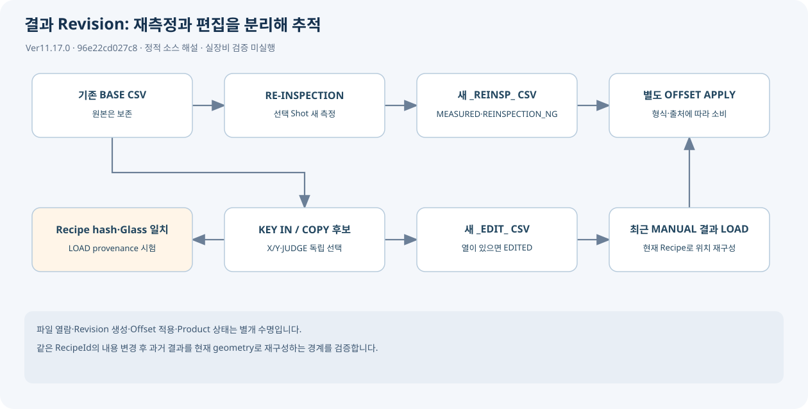
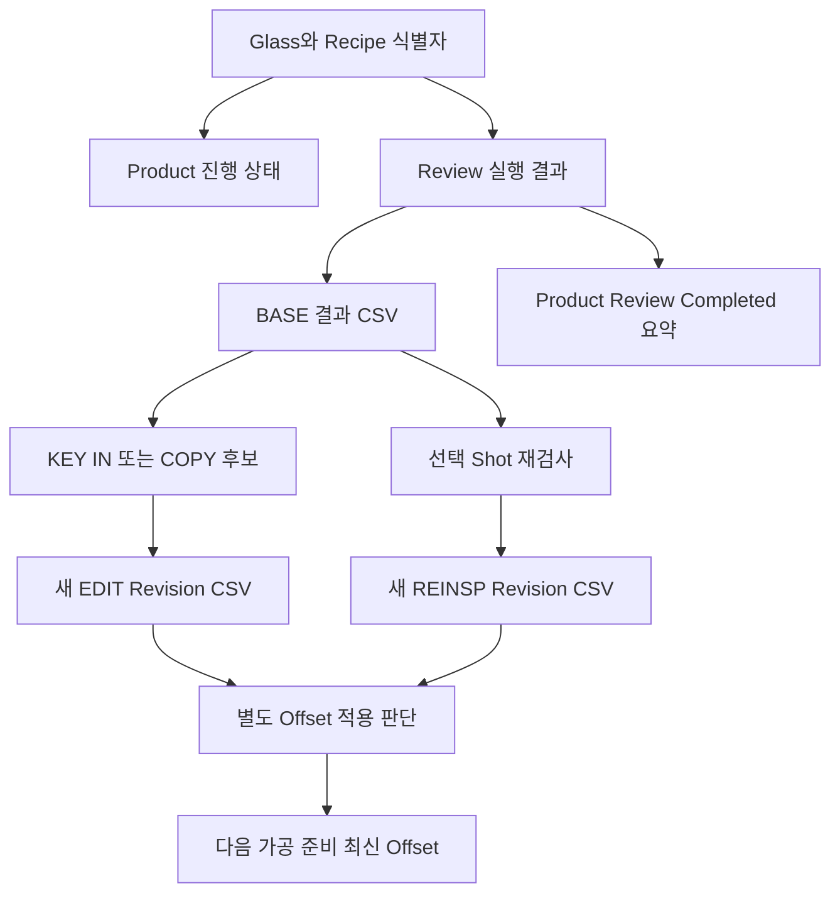

# ReviewResult·재검사 Revision·Product 이력의 결합

원본: `kjuws10-rgb/A3Drilling` · `master` · `96e22cd027c84bf302b23f2949b98985d7f301bb`

현재 재검토: **11.17.0 / 2026-11-18**, 비교 기준 11.13.0(`dfa5920e6301d9ec4b0eab1452ae59521aafc986`). 아래 변경 항목과 기존 잔건을 구분합니다. 파일·함수·호출 경계의 정적 확인이며 장비 실행 시험 결과가 아닙니다.

이 장의 **코드 확인**은 해당 Commit의 실제 함수 본문을 정적으로 추적한 사실입니다. **해설**은 그 구조를 이해하기 위한 설명이며, **검증 과제**는 앞으로 실행할 시험입니다. 실장비의 부호·광학 상태·통신 타이밍·정밀도가 검증되었다는 뜻은 아닙니다. 예시 숫자는 설명용 가상값입니다.

## 1. 세 종류의 이력이 별도로 존재한다

이 프로젝트에서 측정 결과 파일, 보정 snapshot, Product 진행 상태는 다른 자료입니다. ReviewResult는 측정 수치와 판정을 저장합니다. ReviewOffset은 다음 가공에 쓸 보정값을 저장합니다. Product는 현재 Glass/공정의 Review가 Running/Completed인지와 결과 요약을 관리합니다. 파일 하나가 존재한다고 나머지 두 상태가 자동으로 동일하다고 추정하면 안 됩니다. [CReviewResultFile.cs:142–256](https://github.com/kjuws10-rgb/A3Drilling/blob/96e22cd027c84bf302b23f2949b98985d7f301bb/Drilling.File/ReviewResult/CReviewResultFile.cs#L142-L256) [CAutoFineReviewCoordinator.cs:123–168](https://github.com/kjuws10-rgb/A3Drilling/blob/96e22cd027c84bf302b23f2949b98985d7f301bb/Drilling.Common/Review/CAutoFineReviewCoordinator.cs#L123-L168) [CProductManager.cs:444–506](https://github.com/kjuws10-rgb/A3Drilling/blob/96e22cd027c84bf302b23f2949b98985d7f301bb/Drilling.Common/Product/CProductManager.cs#L444-L506)

그림의 Product 화살표는 데이터 책임을 구분한 것입니다. 수동 재검사 Revision을 만들 때 자동으로 과거 Product 요약도 수정되는지 여부는 이 장에서 확인한 파일 함수만으로 보장하지 않습니다.

## 2. 재검사의 UI 입력이 모이는 곳

`SaveReinspectionResult`는 완료된 재검사 항목만 모읍니다. 각 update에는 `CellNo`, `ShotKey`, `ShotName`, 원래 Beam, 실제 재검사 Beam, raw 결과 X/Y, 변환된 결과 X/Y, 상태가 들어갑니다. 사용자가 다른 Beam으로 재검사했을 때 원래 row와 실제 사용 Beam을 구분하는 이유입니다. 완료 update가 없으면 저장을 거부하고 BASE 파일명과 갱신 Shot 수를 확인한 뒤 파일 writer를 호출합니다. [CMenuCorrection.ReviewData.Reinspection.cs:339–395](https://github.com/kjuws10-rgb/A3Drilling/blob/96e22cd027c84bf302b23f2949b98985d7f301bb/Drilling.UI/Menu/Menus/CMenuCorrection.ReviewData.Reinspection.cs#L339-L395)

| 값 | 구분 목적 |
|---|---|
| SourceBeamNo | BASE 결과에서 어떤 측정 행을 바꾸려는지 찾는 단서 |
| BeamNo | 이번 재검사에 실제 선택한 Beam |
| RawResultX/Y | 수신 오차가 어떤 방향이었는지 추적 |
| ResultX/Y | 변환 후 후처리할 오차 |
| Judge/State | 완료 OK인지 완료 NG인지 구분 |

UI 저장은 새 파일 경로를 받으면 unsaved 상태를 해제합니다. 취소와 일반 예외는 별도로 표시합니다. 저장 버튼을 눌렀다는 조작 이력만으로 파일이 생성되었다고 판단하지 말고 성공 경로와 실제 파일명까지 확인해야 합니다. [CMenuCorrection.ReviewData.Reinspection.cs:385–411](https://github.com/kjuws10-rgb/A3Drilling/blob/96e22cd027c84bf302b23f2949b98985d7f301bb/Drilling.UI/Menu/Menus/CMenuCorrection.ReviewData.Reinspection.cs#L385-L411)

## 3. BASE 파일을 덮어쓰지 않는 Revision 생성

`SaveReinspectionRevision`은 source file 존재, header 존재, row 존재를 먼저 확인합니다. `BEAM1_JUDGE` header를 가진 BEAM INSPECTION 결과는 이 재검사 writer로 저장할 수 없습니다. 즉 어떤 결과 타입이든 같은 Revision 함수에 넣을 수 있는 구조가 아닙니다. [CReviewResultFile.cs:142–226](https://github.com/kjuws10-rgb/A3Drilling/blob/96e22cd027c84bf302b23f2949b98985d7f301bb/Drilling.File/ReviewResult/CReviewResultFile.cs#L142-L226)

BASE 행을 dictionary로 복사한 뒤 update마다 검증하고 대상 행을 찾습니다. 같은 BASE row를 두 번 바꾸려 하면 `updatedRowIndexes`가 중복을 차단합니다. 기존 `SAVED_AT` 열이 있으면 Revision 시각 표현을 갱신합니다. 현재 기준 함수는 기존 파일을 직접 overwrite하는 대신 새 고유 CSV를 만듭니다. [CReviewResultFile.cs:228–256](https://github.com/kjuws10-rgb/A3Drilling/blob/96e22cd027c84bf302b23f2949b98985d7f301bb/Drilling.File/ReviewResult/CReviewResultFile.cs#L228-L256)

새 파일 stem은 StripRevisionSuffix가 _REINSP_와 _EDIT_의 마지막 위치를 각각 구한 뒤, 존재하는 두 위치 중 앞선 지점에서 잘라냅니다. 그 뒤 이번 종류(REINSP 또는 EDIT)와 timestamp를 붙입니다. 부모 파일을 덮어쓰지 않고 같은 폴더에 새 고유 파일을 만듭니다. 파일명 축약은 부모/자식 관계의 명시적 ID나 내용 해시를 기록하는 기능과 다릅니다. [CReviewResultFile.cs:251–267](https://github.com/kjuws10-rgb/A3Drilling/blob/96e22cd027c84bf302b23f2949b98985d7f301bb/Drilling.File/ReviewResult/CReviewResultFile.cs#L251-L267)

## 4. 어떤 열을 어떻게 갱신하는가

`ApplyReinspectionUpdate`는 BASE에 **존재하는 열만** 갱신합니다. 아래 이름들은 저장 형식의 호환 열이며, 무조건 모든 결과 CSV에 동시에 존재한다는 뜻은 아닙니다. 좌표 열은 X와 Y가 한 쌍으로 있어야 하며 한쪽만 있으면 실패합니다. 갱신할 좌표 쌍이 하나도 없으면 저장할 수 없습니다. [CReviewResultFile.cs:351–374](https://github.com/kjuws10-rgb/A3Drilling/blob/96e22cd027c84bf302b23f2949b98985d7f301bb/Drilling.File/ReviewResult/CReviewResultFile.cs#L351-L374)

| 열 묶음 | 들어가는 update 값 | 의미 |
|---|---|---|
| `RECV_TARGET_MINUS_HOLE_X/Y`, `RECV_X/Y` | RawResultX/Y | raw 방향 오차 |
| `VISION_FLIP_CONVERT_X/Y`, `CONVERTED_X/Y`, `ERROR_X/Y` | ResultX/Y | 변환된 오차 |
| `BEAM_NO` | BeamNo | 재검사 Beam |
| `JUDGE`, `STATE` | Judge 대문자 | 재검사 판정 |
| `RESULT_SOURCE` | MEASURED | 직접 측정으로 갱신된 행임을 표시 |

**해설:** result CSV의 `ERROR_X/Y`를 모든 코드 경로에서 raw Vision 축이라고 간주하면 안 됩니다. 이 Revision writer는 ResultX/Y를 넣습니다. 결과를 load해 보정할 때 어느 경로에서 flip이 이미 적용되었는지 확인해야 합니다. UI FINE/AUTO delta builder가 `EN_VISION_FLIP_TYPE.Normal`을 전달하는 것도 파일의 변환 후 오차를 다시 flip하지 않기 위한 읽기 관점에서 검토해야 할 연결점입니다. [CReviewResultFile.cs:359–363](https://github.com/kjuws10-rgb/A3Drilling/blob/96e22cd027c84bf302b23f2949b98985d7f301bb/Drilling.File/ReviewResult/CReviewResultFile.cs#L359-L363) [CMenuCorrection.ReviewData.Offset.cs:433–458](https://github.com/kjuws10-rgb/A3Drilling/blob/96e22cd027c84bf302b23f2949b98985d7f301bb/Drilling.UI/Menu/Menus/CMenuCorrection.ReviewData.Offset.cs#L433-L458)

## 5. 측정 행과 보간 행을 구별하는 이유

UI Offset 적용의 `MeasuredRows`는 결과 중 `ResultSource` metadata가 하나라도 있으면 `MEASURED` 행만 사용합니다. metadata가 전혀 없는 Legacy 결과에서는 Judge가 OK 또는 NG인 행을 fallback으로 선택합니다. 이미 보간해 표시한 행을 다시 실측 anchor로 넣으면 보간 결과를 실측처럼 재활용하게 되기 때문에 source 역할을 구분하는 것이 중요합니다. [CMenuCorrection.ReviewData.Offset.cs:461–466](https://github.com/kjuws10-rgb/A3Drilling/blob/96e22cd027c84bf302b23f2949b98985d7f301bb/Drilling.UI/Menu/Menus/CMenuCorrection.ReviewData.Offset.cs#L461-L466)

새 Revision에서 source를 MEASURED로 바꾸는 행과, 미수정된 BASE 행의 기존 source 상태가 함께 남을 수 있습니다. “Revision 파일 전체가 이번에 새로 촬영한 결과”라고 해석하면 안 됩니다. 어떤 Shot이 이번 재검사로 바뀌었는지 update 목록과 원본 연결을 함께 보아야 합니다. [CReviewResultFile.cs:228–248](https://github.com/kjuws10-rgb/A3Drilling/blob/96e22cd027c84bf302b23f2949b98985d7f301bb/Drilling.File/ReviewResult/CReviewResultFile.cs#L228-L248) [CReviewResultFile.cs:369–374](https://github.com/kjuws10-rgb/A3Drilling/blob/96e22cd027c84bf302b23f2949b98985d7f301bb/Drilling.File/ReviewResult/CReviewResultFile.cs#L369-L374)

## 6. Product Review 상태의 정확한 책임

`SetReviewRunning`은 지정 Product의 Review.State를 Running으로 바꾸고 PersistAndLog를 호출합니다. `SetReviewProgress`는 진행 중 snapshot을 Active 저장소에 쓰고 `_current`를 갱신합니다. `SetReviewCompleted`는 Completed, SavedAt, Results의 복사본을 만들고 완료 로그와 함께 저장합니다. 각 함수는 `_updateGate` 안에서 실행됩니다. [CProductManager.cs:444–506](https://github.com/kjuws10-rgb/A3Drilling/blob/96e22cd027c84bf302b23f2949b98985d7f301bb/Drilling.Common/Product/CProductManager.cs#L444-L506)

| 이벤트 | Product 필드 | 다른 자료와의 차이 |
|---|---|---|
| Review 시작 | State=Running | 결과 CSV 완성 전 상태 |
| 진행 갱신 | Running + 진행 Results | 중간 snapshot, 최종 보정 아님 |
| Review 완료 | Completed + SavedAt + Results | Product 요약 완료, Offset 파일 생성과 동일 함수 아님 |
| 재검사 Revision 저장 | ReviewResult 새 파일 | 이 파일 writer 자체는 Product 상태를 수정하지 않음 |

Product 관리자는 시작 시 중단된 진행 상태를 복구하는 경로를 갖지만, 이는 저장 상태의 정리와 이력 처리입니다. 그 사실만으로 Stage가 물리적으로 원점에 복귀했다거나 미완료 가공을 이어서 실행할 수 있다고 결론내려서는 안 됩니다. [CProductManager.cs:25–121](https://github.com/kjuws10-rgb/A3Drilling/blob/96e22cd027c84bf302b23f2949b98985d7f301bb/Drilling.Common/Product/CProductManager.cs#L25-L121)

## 7. 파일 간 연결을 디버깅하는 순서

1. **대상 고정:** GlassId, RecipeId, RunId와 화면에서 연 BASE 파일명을 먼저 확인합니다. 서로 다른 Glass 결과를 비슷한 timestamp만 보고 결합하지 않습니다.
2. **측정 결과:** 실행이 Completed인지, `ResultFilePath`가 있고 `ResultSaveError`가 없는지 봅니다. [CAutoFineReviewCoordinator.cs:43–76](https://github.com/kjuws10-rgb/A3Drilling/blob/96e22cd027c84bf302b23f2949b98985d7f301bb/Drilling.Common/Review/CAutoFineReviewCoordinator.cs#L43-L76)
3. **행 정합성:** 요구한 검사점과 결과의 식별자 집합·개수가 일치하는지 확인합니다. [CAutoFineReviewCoordinator.cs:171–198](https://github.com/kjuws10-rgb/A3Drilling/blob/96e22cd027c84bf302b23f2949b98985d7f301bb/Drilling.Common/Review/CAutoFineReviewCoordinator.cs#L171-L198)
4. **Revision:** 재검사 대상이 몇 개인지, 어떤 Beam을 썼는지, 새 파일명이 무엇인지 확인합니다. [CMenuCorrection.ReviewData.Reinspection.cs:346–398](https://github.com/kjuws10-rgb/A3Drilling/blob/96e22cd027c84bf302b23f2949b98985d7f301bb/Drilling.UI/Menu/Menus/CMenuCorrection.ReviewData.Reinspection.cs#L346-L398)
5. **보정:** 해당 source 파일에서 Offset을 적용한 적이 있는지, Current/Delta/Final이 무엇인지, 새 Offset snapshot이 무엇인지 봅니다. [CMenuCorrection.ReviewData.Offset.cs:299–331](https://github.com/kjuws10-rgb/A3Drilling/blob/96e22cd027c84bf302b23f2949b98985d7f301bb/Drilling.UI/Menu/Menus/CMenuCorrection.ReviewData.Offset.cs#L299-L331) [CReviewOffsetFile.cs:145–211](https://github.com/kjuws10-rgb/A3Drilling/blob/96e22cd027c84bf302b23f2949b98985d7f301bb/Drilling.File/ReviewOffset/CReviewOffsetFile.cs#L145-L211)
6. **다음 가공:** 준비 parameter에 load된 Offset 파일명과 시각을 확인합니다. 과거 Product가 Completed라는 사실만 보지 않습니다. [CStationProcess.cs:1547–1561](https://github.com/kjuws10-rgb/A3Drilling/blob/96e22cd027c84bf302b23f2949b98985d7f301bb/Drilling.Common/Station/CStationProcess.cs#L1547-L1561)

## 8. 주석과 Offline Studio 검색어 설계

이 장은 “Review 좌표를 Vision에 전달”이라는 질문을 결과 CSV 작성 함수로만 답하는 오류를 줄이기 위한 보조 문서이기도 합니다. 검색 시 다음 책임을 구분해야 합니다.

| 질문 표현 | 우선 찾을 symbol | 이 장의 연결 |
|---|---|---|
| 좌표 계산 | `CalculateReviewTarget` | 카메라/Stage 목표, 통신 식별자와 구분 |
| Vision 전송 | `CVisionComm.SendPacket` | 실제 TCP byte write 경계 |
| 측정 결과 저장 | `CReviewResultFile.Save...` | 측정 artifact |
| 재검사 저장 | `SaveReinspectionRevision` | BASE 보존, 새 Revision |
| Offset 적용 | `SaveNewFromSource`, `BuildOffsetApplyPlan` | 누적값과 source 이력 |
| Product 완료 | `SetReviewCompleted` | Glass 진행 요약 |

## 9. 검증 과제

| 시험 | 기대 기준 |
|---|---|
| BASE 없는 파일 / header 없음 / rows 없음 | Revision 생성 전 명확한 오류 |
| BEAM INSPECTION 결과를 재검사 writer에 입력 | 허용하지 않음 |
| 한 row를 두 update가 지정 | 중복 row 갱신 거부 |
| X열만 있고 Y열 없는 Legacy CSV | 부분 좌표 저장 거부 |
| 다른 Beam으로 재측정 | source row 식별은 정확하고 BEAM_NO는 새 Beam으로 갱신 |
| Revision의 Revision 저장 | 중첩 suffix 없이 새 고유 파일, 기존 두 파일 유지 |
| MEASURED와 보간 행 혼합 | 실측 anchor만 보정 입력으로 선택 |
| Product progress 중 저장 예외 | 완료로 오인하지 않고 실제 저장 실패 드러남 |
| UI에서 결과만 확인 후 닫기 | Offset 최신 파일이 바뀌지 않음 |

검증 방법은 synthetic CSV와 가짜 Product 저장소를 이용한 단위·통합시험을 우선 권장합니다. 현장 파일의 실제 측정 행은 이 문서에 복제하지 않았습니다.

## 10. RESULT EDIT: 무엇을 누르면 어떤 자료가 바뀌는가

REVIEW DATA는 결과 트리에서 파일 선택 → DATA LOAD → Cell/Shot/산포도 탐색 순서입니다. 산포도는 현재 선택 Cell의 유한한 Result X/Y를 mm 축에 그립니다. MIN<MAX·UNIT>0·40칸 이하를 확인하며 범위 밖 점은 그리지 않습니다. 사라진 점이 측정 삭제된 것은 아닙니다. 표시 요약의 POINTS와 VISIBLE 개수를 함께 확인해야 합니다. [CMenuCorrection.ReviewData.Display.cs:694–856](https://github.com/kjuws10-rgb/A3Drilling/blob/96e22cd027c84bf302b23f2949b98985d7f301bb/Drilling.UI/Menu/Menus/CMenuCorrection.ReviewData.Display.cs#L694-L856)

RESULT EDIT MODE는 데이터가 LOAD되어 있고 재검사 모드가 아닐 때 열 수 있습니다. 재검사 모드 진입도 EDIT 모드와 상호 배제합니다. 하지만 모드 종료가 편집 목록을 전부 초기화하는 것은 아닙니다. 모드 OFF는 선택 표시를 지우며, 다른 결과를 실제 LOAD하여 ClearLoadedDisplay/ResetResultEditState가 실행될 때 목록과 source/target도 초기화합니다. [CMenuCorrection.ReviewData.cs:81–89](https://github.com/kjuws10-rgb/A3Drilling/blob/96e22cd027c84bf302b23f2949b98985d7f301bb/Drilling.UI/Menu/Menus/CMenuCorrection.ReviewData.cs#L81-L89) [CMenuCorrection.ReviewData.cs:166–188](https://github.com/kjuws10-rgb/A3Drilling/blob/96e22cd027c84bf302b23f2949b98985d7f301bb/Drilling.UI/Menu/Menus/CMenuCorrection.ReviewData.cs#L166-L188) [CMenuCorrection.ReviewData.Reinspection.cs:39–49](https://github.com/kjuws10-rgb/A3Drilling/blob/96e22cd027c84bf302b23f2949b98985d7f301bb/Drilling.UI/Menu/Menus/CMenuCorrection.ReviewData.Reinspection.cs#L39-L49) [CMenuCorrection.ReviewData.Edit.cs:554–573](https://github.com/kjuws10-rgb/A3Drilling/blob/96e22cd027c84bf302b23f2949b98985d7f301bb/Drilling.UI/Menu/Menus/CMenuCorrection.ReviewData.Edit.cs#L554-L573)

### KEY IN

현재 Shot 추가, 체크한 Shot 추가, 전체 NG Shot 추가를 선택합니다. 전체 NG 추가는 현재 Cell의 보이는 행만이 아니라 _allRows에서 NG를 고릅니다. 항목은 CellNo+BeamNo+ShotKey로 중복을 막고 번호를 다시 매깁니다. 추가 직후 ORG X/Y를 소수3자리로 보여 주고 EDIT X/Y·EDIT J를 편집합니다. 숫자는 InvariantCulture 유한값이어야 합니다. 사용자가 OK를 고르면 소스 허용오차를 다시 계산해서 OK인지 검증하는 경로는 SaveResultEdit에 없습니다. [CMenuCorrection.ReviewData.Edit.cs:244–277](https://github.com/kjuws10-rgb/A3Drilling/blob/96e22cd027c84bf302b23f2949b98985d7f301bb/Drilling.UI/Menu/Menus/CMenuCorrection.ReviewData.Edit.cs#L244-L277) [CMenuCorrection.ReviewData.Edit.cs:407–458](https://github.com/kjuws10-rgb/A3Drilling/blob/96e22cd027c84bf302b23f2949b98985d7f301bb/Drilling.UI/Menu/Menus/CMenuCorrection.ReviewData.Edit.cs#L407-L458) [CMenuCorrection.ReviewData.Edit.cs:628–708](https://github.com/kjuws10-rgb/A3Drilling/blob/96e22cd027c84bf302b23f2949b98985d7f301bb/Drilling.UI/Menu/Menus/CMenuCorrection.ReviewData.Edit.cs#L628-L708)

### COPY

SOURCE는 정확히 한 Shot이어야 합니다. 여러 선택이 있으면 경고하고, 선택 체크가 없으면 현재 SelectedRow를 사용합니다. 대상은 source와 같은 행 및 이미 추가된 행을 제외합니다. COPY X/Y는 source의 OriginalXText/YText만, COPY JUDGE는 OriginalJudge만, COPY ALL은 둘 다 복사합니다. 기준 항목의 편집 후보값을 다시 복제하는 기능이 아닙니다. source/target에 서로 다른 Cell·Head가 있는 것을 이 함수가 금지하지는 않습니다. [CMenuCorrection.ReviewData.Edit.cs:234–238](https://github.com/kjuws10-rgb/A3Drilling/blob/96e22cd027c84bf302b23f2949b98985d7f301bb/Drilling.UI/Menu/Menus/CMenuCorrection.ReviewData.Edit.cs#L234-L238) [CMenuCorrection.ReviewData.Edit.cs:302–405](https://github.com/kjuws10-rgb/A3Drilling/blob/96e22cd027c84bf302b23f2949b98985d7f301bb/Drilling.UI/Menu/Menus/CMenuCorrection.ReviewData.Edit.cs#L302-L405)

지도 드래그는 현재 Cell에서 사각형 안에 **Shot 중심점**이 들어온 행을 선택합니다. 산포도 드래그는 현재 보이는 hit 목록에서 점을 선택합니다. 새 사각형 선택은 이전 전체 체크를 먼저 지운 뒤 대체합니다. 드래그가 가로·세로 모두5픽셀 미만이면 단일 점을 고르고 그 현재 Shot 하나로 선택을 바꿉니다. 범위 밖 산포도 점을 포함해 전체 NG를 복사하려면 별도의 NG/목록 조작과 대조해야 합니다. [CMenuCorrection.ReviewData.Edit.cs:158–214](https://github.com/kjuws10-rgb/A3Drilling/blob/96e22cd027c84bf302b23f2949b98985d7f301bb/Drilling.UI/Menu/Menus/CMenuCorrection.ReviewData.Edit.cs#L158-L214) [CReviewDataView.xaml.cs:157–219](https://github.com/kjuws10-rgb/A3Drilling/blob/96e22cd027c84bf302b23f2949b98985d7f301bb/Drilling.UI/Views/CReviewDataView.xaml.cs#L157-L219)

### RESULT SAVE

1. KEY IN이면 그 목록, COPY면 target 목록만 읽습니다.
2. EDIT X/Y를 숫자로 확인하고 표시된 ORG(소수3자리) 및 원 판정과 달라진 항목만 update로 만듭니다. 변하지 않은 축은 Source.ResultX/Y 원래 정밀도를 유지합니다.
3. BASE 파일명과 수정 Shot 수를 확인한 뒤 SaveEditedRevision을 호출합니다. 이때 새 측정을 하지 않고 SourceBeamNo를 보존합니다.
4. writer는 BASE 파일을 디스크에서 다시 읽고 행을 식별합니다. source가 메모리에 LOAD된 뒤 외부에서 수정되었는지 내용 해시로 비교하는 절차는 보이지 않습니다.
5. 새 _EDIT_ 파일을 저장한 뒤, 다시 LOAD할지 묻습니다. 거절하면 화면은 기존 결과에 머무르므로 저장 파일과 현재 LOAD 파일명을 구분해야 합니다.

[CMenuCorrection.ReviewData.Edit.cs:407–519](https://github.com/kjuws10-rgb/A3Drilling/blob/96e22cd027c84bf302b23f2949b98985d7f301bb/Drilling.UI/Menu/Menus/CMenuCorrection.ReviewData.Edit.cs#L407-L519) [CReviewResultFile.cs:157–267](https://github.com/kjuws10-rgb/A3Drilling/blob/96e22cd027c84bf302b23f2949b98985d7f301bb/Drilling.File/ReviewResult/CReviewResultFile.cs#L157-L267)

## 11. 원본 보존과 추적성의 범위

| 항목 | 현재 EDIT writer 동작 | 해석 경계 |
|---|---|---|
| 기존 BASE | overwrite하지 않음 | 원본 보존과 새 파일 계보의 완전성은 별개 |
| 좌표 | 변환열 3쌍 중 존재하는 쌍 모두 갱신 | raw열이 함께 있으면 이전 raw를 유지하므로 새 변환값과 수학적으로 맞지 않을 수 있음 |
| 변환열 전부 없음 | RECV_TARGET_MINUS_HOLE/RECV에 수정값 fallback | 이름은 raw지만 값은 UI의 변환 후 결과일 수 있어 Flip 의미 확인 필요 |
| 판정 | JUDGE/STATE에 사용자가 정한 OK/NG | 새 촬영·허용오차 통과가 자동 입증되지 않음 |
| 출처 | RESULT_SOURCE 열이 있을 때 EDITED | 없는 형식에는 새 출처 열을 만들지 않음 |
| 원인/코드 | VISION_RESULT_CODE 빈 값, NG이면 RESULT_EDIT | 원래 Vision code/원인을 이 행에서 잃음; 원 BASE에는 남음 |
| 시각 | 기존 SAVED_AT를 모든 행에서 Revision 시각으로 갱신 | 수정되지 않은 행도 새 촬영한 것처럼 시각을 읽으면 안 됨 |
| 변경 이력 | 새 파일명과 변경된 열 | 사용자·사유·source Shot/부모 hash·기준 OffsetRevision을 추가 기록하는 계약은 없음 |

[CReviewResultFile.cs:228–267](https://github.com/kjuws10-rgb/A3Drilling/blob/96e22cd027c84bf302b23f2949b98985d7f301bb/Drilling.File/ReviewResult/CReviewResultFile.cs#L228-L267) [CReviewResultFile.cs:376–426](https://github.com/kjuws10-rgb/A3Drilling/blob/96e22cd027c84bf302b23f2949b98985d7f301bb/Drilling.File/ReviewResult/CReviewResultFile.cs#L376-L426)

**정밀도 확인:** COPY는 source의 F3 표시 문자열을 사용하므로 원본이0.01234 mm라면 다른 target에 복사되는 후보는0.012 mm입니다. 이것은 설명용 값입니다. 무변경 저장에서는 F3와 비교하여 같으면 update를 만들지 않아 원 정밀도를 보존합니다. 단일축 변경 시 반대축도 원 수치를 유지합니다. 복사 정밀도와 표시 정밀도, 저장 정밀도를 같은 것으로 설명하지 않습니다. [CMenuCorrection.ReviewData.Edit.cs:428–456](https://github.com/kjuws10-rgb/A3Drilling/blob/96e22cd027c84bf302b23f2949b98985d7f301bb/Drilling.UI/Menu/Menus/CMenuCorrection.ReviewData.Edit.cs#L428-L456) [CMenuCorrection.ReviewData.Edit.cs:653–655](https://github.com/kjuws10-rgb/A3Drilling/blob/96e22cd027c84bf302b23f2949b98985d7f301bb/Drilling.UI/Menu/Menus/CMenuCorrection.ReviewData.Edit.cs#L653-L655)

**UI 근거 표시:** 새 result model에는 ResultSource/VisionResultCode/NgReason가 있으나 ST_REVIEW_DATA_GRID_ROW는 Head·Cell·Shot·Beam·ResultX/Y·Judge 위주이고 이 세 metadata를 넘기지 않습니다. 따라서 산포도의 초록색/그리드 OK만으로 MEASURED와 EDITED를 구별할 수 있다고 주장할 근거가 없습니다. [CReviewResultFile.cs:503–521](https://github.com/kjuws10-rgb/A3Drilling/blob/96e22cd027c84bf302b23f2949b98985d7f301bb/Drilling.File/ReviewResult/CReviewResultFile.cs#L503-L521) [CMenuCorrection.ReviewData.Display.cs:284–300](https://github.com/kjuws10-rgb/A3Drilling/blob/96e22cd027c84bf302b23f2949b98985d7f301bb/Drilling.UI/Menu/Menus/CMenuCorrection.ReviewData.Display.cs#L284-L300) [CMenuCorrection.ReviewData.Display.cs:1481–1507](https://github.com/kjuws10-rgb/A3Drilling/blob/96e22cd027c84bf302b23f2949b98985d7f301bb/Drilling.UI/Menu/Menus/CMenuCorrection.ReviewData.Display.cs#L1481-L1507)

## 12. Product 메모리와 재시작 저장의 차이

CReviewManager는 새 NG metadata를 ST_PRODUCT_REVIEW_RESULT에 채우며 실행 중 Product 결과를 계획에 복원할 때도 읽습니다. 그러나 CProductFile의 compact 저장은 여전히 HEAD/CELL/BEAM/ERROR_X/ERROR_Y/JUDGE 6개 필드만 기록하고, Load도 기존 생성자만 사용합니다. 따라서 메모리에서 보이던 VisionResultCode/NgReason는 Active Product 저장→재시작 복원에서 기본 null/빈 값으로 빠질 수 있습니다. [CReviewManager.cs:1651–1667](https://github.com/kjuws10-rgb/A3Drilling/blob/96e22cd027c84bf302b23f2949b98985d7f301bb/Drilling.Common/Review/CReviewManager.cs#L1651-L1667) [CReviewManager.cs:1751–1774](https://github.com/kjuws10-rgb/A3Drilling/blob/96e22cd027c84bf302b23f2949b98985d7f301bb/Drilling.Common/Review/CReviewManager.cs#L1751-L1774) [CProductFile.cs:168–175](https://github.com/kjuws10-rgb/A3Drilling/blob/96e22cd027c84bf302b23f2949b98985d7f301bb/Drilling.File/Product/CProductFile.cs#L168-L175) [CProductFile.cs:309–320](https://github.com/kjuws10-rgb/A3Drilling/blob/96e22cd027c84bf302b23f2949b98985d7f301bb/Drilling.File/Product/CProductFile.cs#L309-L320)

ReviewResult CSV에는 새 metadata 열이 남을 수 있으므로 결과 파일을 직접 LOAD하면 그 파일의 metadata는 읽힙니다. 그러나 이 동작이 Active Product의 누락 필드를 자동으로 역주입한다는 호출은 본 경로에 없습니다. **CSV 보존, UI 표시, Product 영속성은 각각 별도로 검사**해야 합니다. [CReviewResultFile.cs:503–521](https://github.com/kjuws10-rgb/A3Drilling/blob/96e22cd027c84bf302b23f2949b98985d7f301bb/Drilling.File/ReviewResult/CReviewResultFile.cs#L503-L521) [CMenuCorrection.ReviewData.Display.cs:177–190](https://github.com/kjuws10-rgb/A3Drilling/blob/96e22cd027c84bf302b23f2949b98985d7f301bb/Drilling.UI/Menu/Menus/CMenuCorrection.ReviewData.Display.cs#L177-L190)

## 13. 형식별 검증 시나리오

| 시나리오 | 반드시 확인할 결과 |
|---|---|
| ALL/FINE의 NG를 COPY JUDGE로 OK | 새 파일 EDITED 여부, MeasuredRows에서 제외되는지, 남은 anchor로 적용되는지 |
| ONE SHOT 결과 EDIT/OK | RESULT_SOURCE 헤더 부재와 legacy fallback, 수정값 OFFSET APPLY 후보 여부 |
| COPY X/Y만 / JUDGE만 / ALL | 좌표와 판정이 각각 독립적으로 바뀌고 새 측정으로 오인하지 않는지 |
| 같은 F3를 갖는 고정밀 source/target | 무변경 경고·원축 정밀도 유지·복사 반올림 범위 |
| raw+converted 동시 헤더 | EDIT 후 raw는 유지되고 converted만 바뀌는 차이를 명시할 수 있는지 |
| 결과 LOAD 뒤 source 파일 외부 변경 | 저장 시 다시 읽힌 BASE와 화면 ORG가 불일치할 가능성 |
| REINSP→EDIT→REINSP | 각 파일 원본 보존·suffix·행 수·판정/코드/출처 변환 |
| 같은 내용을 다른 Revision 경로로 APPLY | BASE의 이미 적용한 MEASURED 행이 다시 누적되는지 |
| NG metadata 포함 Product 저장·재시작 | 판정은 남지만 원인/코드가 빠지는지, CSV와 차이가 있는지 |

이 표는 합성 CSV·가짜 저장소에서 우선 재현할 계획입니다. 문서 작성 중 실측 행이나 운영 CSV를 열어 검증하지 않았고 장비/카메라를 실행하지 않았습니다.

## 14. 11.17.0 최근 결과 LOAD와 실행 잠금

ALL SHOT·ONE SHOT·ONE LINE에 LAST RESULT LOAD/CLEAR가 추가됩니다. Manager는 catalog에서 Source=MANUAL, 같은 RecipeId와 ResultType을 고릅니다. catalog의 SavedAt 내림차순 첫 파일을 읽고 UI는 cancellation/generation으로 과거 비동기 응답이 새 모드를 덮지 않게 합니다. LOAD 중 또는 로드 결과가 남아 있을 때 새 검사·이동 관련 조작을 차단합니다. 파일 열람은 새 측정이나 Offset 적용이 아닙니다. [CMenuReview.cs:2436–2536](https://github.com/kjuws10-rgb/A3Drilling/blob/96e22cd027c84bf302b23f2949b98985d7f301bb/Drilling.UI/Menu/Menus/CMenuReview.cs#L2436-L2536) [CReviewResultFile.Catalog.cs:12–28](https://github.com/kjuws10-rgb/A3Drilling/blob/96e22cd027c84bf302b23f2949b98985d7f301bb/Drilling.File/ReviewResult/CReviewResultFile.Catalog.cs#L12-L28)

로드 화면은 현재 Recipe로 계획을 다시 만들고 파일 Shift·Beam·오차/판정을 얹습니다. ShotKey 우선, 실패하면 Cell의 ShotName으로 찾습니다. 같은 RecipeId는 확인하지만 Recipe 내용 hash/당시 Head배정/Geometry revision을 맞추는 검증은 이 경로에서 보이지 않습니다. 같은 ID의 Recipe가 수정되면 과거 좌표와 현재 재구성 좌표를 혼동할 수 있어 provenance 검증이 필요합니다. [CMenuReview.cs:2539–2603](https://github.com/kjuws10-rgb/A3Drilling/blob/96e22cd027c84bf302b23f2949b98985d7f301bb/Drilling.UI/Menu/Menus/CMenuReview.cs#L2539-L2603)

| 대상 | 현재 키 / 동작 | 한계 |
|---|---|---|
| 최근 파일 | MANUAL+RecipeId+ResultType+SavedAt | 현재 GlassId 전용 조회 아님 |
| 위치 재구성 | 현재 Recipe+파일 Shift+행 Beam | 과거 Recipe hash 검증 없음 |
| 행 연결 | ShotKey / Cell+ShotName fallback | 설계 변경·동명이름 시험 |
| 여러 Beam 같은 Shot | ShotKey dictionary에 마지막 행 | BEAM INSP 전용 loader와 구분 |
| 결과 색 | 현재 OPTION 임계색 재계산 | 당시 등급 snapshot 저장 아님 |
| Product | 실행 상태·요약 | 과거 열람은 Product 재측정 아님 |

일반 ReviewResult·Revision·ReviewOffset·Product writer는 이번 diff에서 바뀌지 않았습니다. Default 로그에 DOE_EXIST/DEFAULT_INSPECTION_POINT_COUNT가 추가된 것은 별도입니다. 실제 측정 CSV는 복제하지 않고 스키마·생성·소비 코드만 연결합니다.

시험은 같은 RecipeId의 모델/Cell 변경 후 과거 LOAD, 다른 Glass의 최근 MANUAL, 저장시각 동률, LOAD 중 Recipe 변경, NG/RETAINED/EDITED 혼합을 나눕니다. 잠금·실제 파일 경로·재구성 좌표·별도 보정 후보를 비교합니다.

최근 MANUAL 선택 helper 근거: [CReviewManager.cs:1561–1578](https://github.com/kjuws10-rgb/A3Drilling/blob/96e22cd027c84bf302b23f2949b98985d7f301bb/Drilling.Common/Review/CReviewManager.cs#L1561-L1578)

### Live·최근 LOAD·REVIEW DATA의 색상은 따로 확인합니다

| 경로 | 상태·등급 처리 | 색상 해석 |
|---|---|---|
| Live 검사 | Ready/WAIT는 등급 결과가 아니고 VisionFind NG도 등급에서 제외 | Current의 녹색 점멸은 현재 검사점/진행 상태 표시이며 품질 OK색이 아님 |
| 최근 MANUAL LOAD | 파일의 비OK 행은 State=Ng/Judge=NG로 정규화하고 NgReason은 보존 | VisionFind NG는 등급 제외되지만, 오차0·Reason빈값의 비OK 행은 L1이 될 수 있음 |
| REVIEW DATA 파일 LOAD | 각 로드 행의 ErrorX/Y로 Level을 계산 | 낮은 Level 색과 원행의 Judge·출처를 함께 봐야 함 |

[CMenuReview.cs:2552–2594](https://github.com/kjuws10-rgb/A3Drilling/blob/96e22cd027c84bf302b23f2949b98985d7f301bb/Drilling.UI/Menu/Menus/CMenuReview.cs#L2552-L2594) [CMenuReview.cs:4707–4737](https://github.com/kjuws10-rgb/A3Drilling/blob/96e22cd027c84bf302b23f2949b98985d7f301bb/Drilling.UI/Menu/Menus/CMenuReview.cs#L4707-L4737) [CReviewShotMapControl.cs:282–299](https://github.com/kjuws10-rgb/A3Drilling/blob/96e22cd027c84bf302b23f2949b98985d7f301bb/Drilling.UI/Views/CReviewShotMapControl.cs#L282-L299) [CMenuCorrection.ReviewData.Display.cs:274–300](https://github.com/kjuws10-rgb/A3Drilling/blob/96e22cd027c84bf302b23f2949b98985d7f301bb/Drilling.UI/Menu/Menus/CMenuCorrection.ReviewData.Display.cs#L274-L300)
