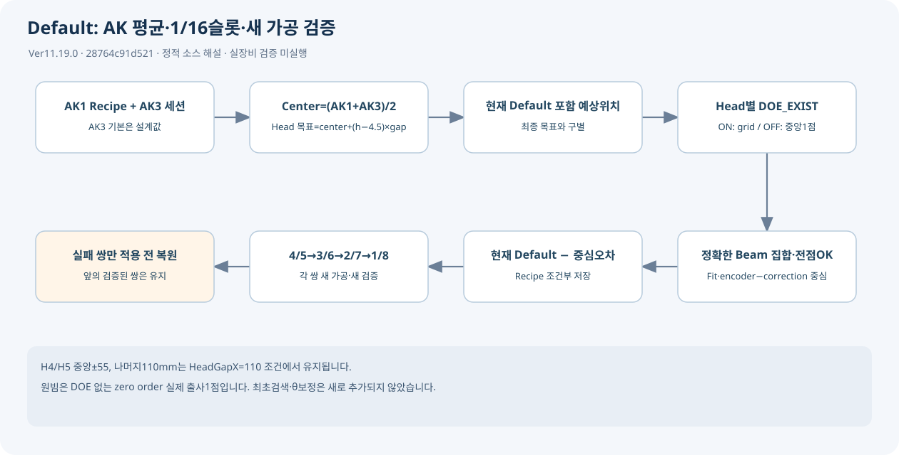

# Default Offset·Zero Order·First Beam: AK 중앙·DOE 슬롯·복원 범위

원본: kjuws10-rgb/A3Drilling · master · dfa5920e6301d9ec4b0eab1452ae59521aafc986 · Ver11.13.0

이 장은 이전11.10.0의 “중앙은 설계치만 사용, Shot16점/Cross1점” 설명을 새 구현으로 대체합니다. 실제 함수와 호출자를 정적으로 읽었습니다. 실장비 이동·레이저 가공·AeroScript·벤더 DLL을 실행하지 않았으며, 아래 시험은 실행 계획입니다. 숫자 예시는 설명용 가상값입니다.

## 1. 먼저 구분해야 하는 다섯 값

| 이름 | 현재 코드에서의 뜻 | 서로 혼동하면 생기는 문제 |
|---|---|---|
| AK1 Review X | Recipe의 REVIEW_CAMERA_ALIGN_KEY_POS_X | 지금 새로 측정한 좌표로 오인 |
| AK3 Review X | 기본은 설계 계산값, 조건창에서 세션값으로 변경 가능 | 수동 입력을 자동 촬영·검증으로 오인 |
| BoardCenterX | 조건에 적용한 두 Review X의 정확한 평균 | global X/Y 기판 회전 피팅으로 과장 |
| Head Default | 모든 해당 Head Shot에 쓰는 기본 보정 | 평가용 Beam11 추가 이동량과 혼합 |
| First Beam Offset | Default와 독립된 X/Y 추가 offset | Zero Order calibration 자체로 오인 |

이번 변경은 AK3를 실측 encoder 값으로 **입력할 수 있는 세션 경로**를 추가합니다. Conditions 함수가 매번 AK1/AK3를 새로 촬영하거나 PLC의 글로벌 AK4점을 가져오는 것은 아닙니다. [CDefaultOffsetCalibration.cs:29–55](https://github.com/kjuws10-rgb/A3Drilling/blob/dfa5920e6301d9ec4b0eab1452ae59521aafc986/Drilling.Common/Correction/CDefaultOffsetCalibration.cs#L29-L55) [CDefaultOffsetView.xaml.cs:78–112](https://github.com/kjuws10-rgb/A3Drilling/blob/dfa5920e6301d9ec4b0eab1452ae59521aafc986/Drilling.UI/Views/CDefaultOffsetView.xaml.cs#L78-L112) [CDefaultOffsetView.xaml.cs:176–192](https://github.com/kjuws10-rgb/A3Drilling/blob/dfa5920e6301d9ec4b0eab1452ae59521aafc986/Drilling.UI/Views/CDefaultOffsetView.xaml.cs#L176-L192)

~~~mermaid
flowchart TD
 A[Recipe AK1 Review X] --> C[AK1과 AK3 Review X의 평균]
 B[AK3 설계 계산 또는 조건창 입력] --> C
 C --> T[각 Head의 고정 목표 중심]
 F[현재 Default와 탐색 teaching] --> M[예상 마크 위치로 이동]
 M --> D[DOE 1개 또는16개 슬롯 Capture]
 D --> V[완전한 슬롯 집합과 Fit 검사]
 V --> E[encoder와 보정으로 실측 중심]
 T --> G[실측 중심과 목표의 차이]
 E --> G
 G --> R[현재 Default에서 오차 차감]
 R --> P[Recipe 조건부 저장]
 P --> Q[새 가공과 새 측정으로 재검증]
 Q --> N[성공한 쌍 유지하고 다음 쌍]
 Q --> X[실패한 쌍만 적용 전으로 복원]
~~~

## 2. 측정 조건창의 실제 조작 흐름

1. Default 측정 조건에서 현재 Recipe와 Setting을 합칩니다. 이 helper는 Setting을 먼저 넣고 Recipe가 같은 키를 덮습니다.
2. AK1은 Recipe 값으로 읽기 전용입니다. AK3는 편집 가능하고 “설계값 계산”을 누르면 AK1+GlassSizeX−2×AK_MARGIN_X로 되돌립니다. 이 버튼은 encoder 현재값을 채집하지 않습니다.
3. Stage Y, 기준 모델, Shot/십자 가공, 십자 길이를 정합니다. Vision 방식은 Shot이면 Mark Find Single, 십자이면 Mark Find Setting Single로 자동 정해집니다.
4. 두 X의 평균을 미리 보여 주고 조건 적용 시 유한값·양수 tolerance·AK1≠AK3·지원 DOE 크기·십자 양수 길이를 검증합니다.
5. 이전 조건을 다시 열면 AK3 세션값과 가공 방식/길이를 유지하는 분기가 있습니다. 실제 Recipe가 바뀌었을 때 이 값의 출처도 다시 확인해야 합니다.
6. 조건 적용은 측정 run을 준비합니다. Head Default 추천값을 Recipe에 저장하는 APPLY와 다른 단계입니다.

[CDefaultOffsetCalibration.cs:14–19](https://github.com/kjuws10-rgb/A3Drilling/blob/dfa5920e6301d9ec4b0eab1452ae59521aafc986/Drilling.Common/Correction/CDefaultOffsetCalibration.cs#L14-L19) [CDefaultOffsetCalibration.cs:97–108](https://github.com/kjuws10-rgb/A3Drilling/blob/dfa5920e6301d9ec4b0eab1452ae59521aafc986/Drilling.Common/Correction/CDefaultOffsetCalibration.cs#L97-L108) [CMenuCorrection.cs:3175–3199](https://github.com/kjuws10-rgb/A3Drilling/blob/dfa5920e6301d9ec4b0eab1452ae59521aafc986/Drilling.UI/Menu/Menus/CMenuCorrection.cs#L3175-L3199) [CDefaultOffsetView.xaml.cs:78–147](https://github.com/kjuws10-rgb/A3Drilling/blob/dfa5920e6301d9ec4b0eab1452ae59521aafc986/Drilling.UI/Views/CDefaultOffsetView.xaml.cs#L78-L147) [CDefaultOffsetView.xaml.cs:176–194](https://github.com/kjuws10-rgb/A3Drilling/blob/dfa5920e6301d9ec4b0eab1452ae59521aafc986/Drilling.UI/Views/CDefaultOffsetView.xaml.cs#L176-L194)

조건창은 “실측 중앙”이라고 표시하지만 AK3가 설계 fallback인지 실제 encoder 값을 사람이 확인해 넣었는지 구분하는 전용 provenance 플래그는 Options에 없습니다. 따라서 표시 문구만으로 새 실측 중앙이라고 인증해서는 안 됩니다. Options에 남는 것은 두 X, Stage Y, tolerance, mode, cross size, DOE grid 크기입니다. [CDefaultOffsetCalibration.cs:265–285](https://github.com/kjuws10-rgb/A3Drilling/blob/dfa5920e6301d9ec4b0eab1452ae59521aafc986/Drilling.Common/Correction/CDefaultOffsetCalibration.cs#L265-L285)

## 3. 중앙과 Head 목표: ±55/110의 조건

~~~text
AK3_design_X = AK1_X + GlassSizeX − 2 × AK_MARGIN_X
Center_X     = (Options.AK1_X + Options.AK3_X) / 2
Target_X(h)  = Center_X + (h − 4.5) × HeadGapX
Target_Y(h)  = Test_Q − StageDirection × HeadGapY(h)
~~~

HeadGapX가110 mm일 때 H4/H5는 중앙에서−55/+55 mm입니다. H1..8 상대 X는 각각−385,−275,−165,−55,+55,+165,+275,+385 mm입니다. 이는 110 mm라는 설정을 넣었을 때의 계산이지 현재 설비값을 문서에 가져온 것이 아닙니다. odd/even Head의 Y 행 간격도 별도 사용합니다. [CDefaultOffsetCalibration.cs:207–231](https://github.com/kjuws10-rgb/A3Drilling/blob/dfa5920e6301d9ec4b0eab1452ae59521aafc986/Drilling.Common/Correction/CDefaultOffsetCalibration.cs#L207-L231)

가상 AK1=100, AK3=900이면 중앙500입니다. AK3 입력만902로 바꾸면 중앙501이고 모든 Head 목표 X가1 mm 이동합니다. H4 측정만 바꾸어도 H3 목표가 이어서 바뀌는 구조는 아닙니다. 짝별 실행 순서는4/5→3/6→2/7→1/8이지만 **앞 쌍 실측을 다음 쌍의 전역 중앙으로 삼는 연쇄 calibration이 아닙니다.** [CDefaultOffsetCalibration.cs:204–220](https://github.com/kjuws10-rgb/A3Drilling/blob/dfa5920e6301d9ec4b0eab1452ae59521aafc986/Drilling.Common/Correction/CDefaultOffsetCalibration.cs#L204-L220) [CMenuCorrection.cs:3350–3364](https://github.com/kjuws10-rgb/A3Drilling/blob/dfa5920e6301d9ec4b0eab1452ae59521aafc986/Drilling.UI/Menu/Menus/CMenuCorrection.cs#L3350-L3364)

AK3 설계 fallback을 그대로 쓰면 평균은 이전의 AK1+GlassSizeX/2−AK_MARGIN_X와 같습니다. 반면 사람이 입력한 AK3를 쓰면 새 평균이 적용됩니다. 따라서 이전 설명의 “항상 설계중앙만 사용한다”는 문장은 현재에 맞지 않으며, “항상 두 점을 자동 새 측정한다”는 문장도 맞지 않습니다.

이 기능은 X 두 값의 평균입니다. AK1/AK3의 global Y 차이, 두 점 선의 atan2 회전, 기판의2D 중심/자세는 계산하지 않습니다. Distortion의 AK4점 수신·보간과 이 옵션 평균을 같은 계산으로 취급하지 않습니다.

## 4. DOE 1×1과4×4: Shot과십자 모두 슬롯별 검사

BeamGridSize는 Recipe 전역 SPLITED_BEAM_COUNT가 정수1 또는4인지 확인합니다. 1이면 beam1 한 개, pitch0, local slot(0,0)입니다. 4이면 beam1..16과 양수 pitch를 사용하고 모델의 ProcessPitch×PIXEL_SIZE/4로 간격을 구합니다. 슬롯은 격자 중심을 원점으로 하고 Head별 DOE 회전각으로 회전합니다. [CDefaultOffsetCalibration.cs:129–157](https://github.com/kjuws10-rgb/A3Drilling/blob/dfa5920e6301d9ec4b0eab1452ae59521aafc986/Drilling.Common/Correction/CDefaultOffsetCalibration.cs#L129-L157)

| 전역 DOE grid | 가공 방식 | scanner 형태 | Vision 요청·필요 측정 |
|---|---|---|---|
| 1×1 | Shot | 기본 한 점 | Mark Find Single 1회, Beam1 |
| 1×1 | Cross | 중심의 가로·세로 선 | Mark Find Setting Single 1회, Beam1 |
| 4×4 | Shot | 한 번의 scanner Shot이 광학적으로 분기 | Mark Find Single을 각 슬롯에서16회 |
| 4×4 | Cross | scanner가 중심 십자 하나를 그리고 DOE가16형상으로 분기 | Mark Find Setting Single을 각 슬롯에서16회 |

소스의 이전 FitCross/Beam0 한 번 측정은 제거됐습니다. 이제 가공 방식에 관계없이 Options.InspectionPointCount만큼 Capture 후 공통 Fit을 호출합니다. 십자 전체 길이는 각 선의 전체 길이이므로 길이L일 때−L/2~+L/2입니다. DOE 빔 간격은 광학적 분기이며 scanner가 그 간격만큼16번 이동해 십자를 그린다고 읽으면 안 됩니다. [CDefaultOffsetCalibration.cs:111–126](https://github.com/kjuws10-rgb/A3Drilling/blob/dfa5920e6301d9ec4b0eab1452ae59521aafc986/Drilling.Common/Correction/CDefaultOffsetCalibration.cs#L111-L126) [CDefaultOffsetCalibration.cs:265–284](https://github.com/kjuws10-rgb/A3Drilling/blob/dfa5920e6301d9ec4b0eab1452ae59521aafc986/Drilling.Common/Correction/CDefaultOffsetCalibration.cs#L265-L284) [CMenuCorrection.cs:3788–3805](https://github.com/kjuws10-rgb/A3Drilling/blob/dfa5920e6301d9ec4b0eab1452ae59521aafc986/Drilling.UI/Menu/Menus/CMenuCorrection.cs#L3788-L3805)

**한계:** 이 전역 선택은 Head별 광학 mode 표가 아닙니다. 예를 들어3개 Head DOE+5개 Head 원빔을 동시에 자동 구분하고 서로 다른 검사 개수/Beam11 대응을 적용하는 기능까지 확인된 것은 아닙니다. 실제 DOE 유무·원빔 위치·유효 Beam 번호와 Recipe grid 설정의 일치가 필요합니다. Cross를 선택한다고 DOE가 제거되거나 Zero Order 원빔이 되는 것도 아닙니다.

## 5. 측정 예상 위치와 보정 목표 위치는 따로 계산한다

MeasureDefaultCenter의 예상 카메라 위치는 teaching 및 **현재 Default**를 더합니다. 적용 후 새 마크가 이동하므로 카메라가 그 위치를 따라가야 하기 때문입니다. 반면 원하는 Head 위치는2절의 AK 평균+Head 간격입니다. 탐색을 쉽게 하려는 teaching과 최종 목표를 같은 값으로 만들어서는 안 됩니다. [CMenuCorrection.cs:3778–3805](https://github.com/kjuws10-rgb/A3Drilling/blob/dfa5920e6301d9ec4b0eab1452ae59521aafc986/Drilling.UI/Menu/Menus/CMenuCorrection.cs#L3778-L3805)

Capture는 이동 완료 후50ms를 기다리고, 요청 전후 encoder 위치가0.001 mm 넘게 바뀌면 거부합니다. Vision 픽셀의 Target−Hole를 cameraResolution×nResolution으로 mm 변환한 뒤 Vision Flip을 한 번 적용합니다. 이때 mark의 local 실측값은 slot−convertedError입니다. Stage/Review encoder 실측값도 함께 저장합니다. [CReviewManager.cs:3120–3140](https://github.com/kjuws10-rgb/A3Drilling/blob/dfa5920e6301d9ec4b0eab1452ae59521aafc986/Drilling.Common/Review/CReviewManager.cs#L3120-L3140)

~~~text
ActualCenterReviewX = Average(EncoderX − CorrectionX)
ActualCenterStageY  = Average(EncoderY − StageDirection × CorrectionY)
CenterErrorX        = ActualCenterReviewX − TargetReviewX
CenterErrorY        = (ActualCenterStageY − TargetStageY) / StageDirection
~~~

WithHeadReference는1개 또는16개의 완전한 번호 집합을 요구합니다. 실제 배열 중심은 encoder−correction 평균을 사용하므로 명령 target만 평균하는 것과 다릅니다. local Fit의 중심과 stage/global 목표 대비 중심오차도 다른 값입니다. [CDefaultOffsetCalibration.cs:207–231](https://github.com/kjuws10-rgb/A3Drilling/blob/dfa5920e6301d9ec4b0eab1452ae59521aafc986/Drilling.Common/Correction/CDefaultOffsetCalibration.cs#L207-L231)

## 6. Fit과 추천이 허용하는 조건

Fit은 설정한 grid에 해당하는 정확한 개수와 Beam1..N 집합, 모든 Judge=OK, 유한한 local/raw/correction/encoder를 요구합니다.1빔은 그 한 점을 중심으로 반환하고 residual/pitchX/pitchY를0으로 둡니다.1점으로 회전·pitch를 검증했다는 뜻이 아닙니다. [CDefaultOffsetCalibration.cs:160–173](https://github.com/kjuws10-rgb/A3Drilling/blob/dfa5920e6301d9ec4b0eab1452ae59521aafc986/Drilling.Common/Correction/CDefaultOffsetCalibration.cs#L160-L173)

16빔은 평균 중심과 affine 격자 계수를 계산하고, 예상 DOE 각도/간격과의 격자 차이 및 최대 잔차가 tolerance 이하인지 확인합니다. 몇 점이 빠졌을 때 나머지 평균만으로 통과시키는 분기는 없습니다. tolerance는 Recipe Review X/Y 중 작은 값입니다. [CDefaultOffsetCalibration.cs:174–201](https://github.com/kjuws10-rgb/A3Drilling/blob/dfa5920e6301d9ec4b0eab1452ae59521aafc986/Drilling.Common/Correction/CDefaultOffsetCalibration.cs#L174-L201) [CDefaultOffsetCalibration.cs:34–39](https://github.com/kjuws10-rgb/A3Drilling/blob/dfa5920e6301d9ec4b0eab1452ae59521aafc986/Drilling.Common/Correction/CDefaultOffsetCalibration.cs#L34-L39)

Recommend는 지정된 USE Head 집합의 유효 결과가 모두 있어야 하며 nextDefault=Round(currentDefault−CenterError,5,AwayFromZero)를 계산합니다. 유한값과±100 mm를 확인하고 Head flip은 뒤의 scanner 변환에 맡깁니다. ±100 mm 숫자 허용범위와 실제 Scan Field 범위는 다른 경계입니다. [CDefaultOffsetCalibration.cs:237–260](https://github.com/kjuws10-rgb/A3Drilling/blob/dfa5920e6301d9ec4b0eab1452ae59521aafc986/Drilling.Common/Correction/CDefaultOffsetCalibration.cs#L237-L260)

실제 CENTER 명령은 Head transform 이후 X/Y가 Scan Field 반폭 안인지 검사합니다. Shot은 한 점, 십자는4끝점입니다. DOE 분기 간격을 scanner 축 이동범위에 그대로 넣는 구조가 아닙니다. [CDefaultOffsetCalibration.cs:58–67](https://github.com/kjuws10-rgb/A3Drilling/blob/dfa5920e6301d9ec4b0eab1452ae59521aafc986/Drilling.Common/Correction/CDefaultOffsetCalibration.cs#L58-L67) [CDefaultOffsetCalibration.cs:89–126](https://github.com/kjuws10-rgb/A3Drilling/blob/dfa5920e6301d9ec4b0eab1452ae59521aafc986/Drilling.Common/Correction/CDefaultOffsetCalibration.cs#L89-L126)

## 7. 적용·재검증·중단·복원을 단계별로 읽기

일괄 모드는 USE Head를4,5,3,6,2,7,1,8 순서로 가공한 뒤 전체 검사, 추천 계산, 일괄 APPLY, 새 가공 VERIFY를 분리합니다. 검증 실패/취소 때 적용한 값이 있으면 RestoreDefault로 이번 run에서 적용한 키들을 조건 적용 시점 값으로 돌립니다. [CMenuCorrection.cs:3213–3238](https://github.com/kjuws10-rgb/A3Drilling/blob/dfa5920e6301d9ec4b0eab1452ae59521aafc986/Drilling.UI/Menu/Menus/CMenuCorrection.cs#L3213-L3238) [CMenuCorrection.cs:3265–3325](https://github.com/kjuws10-rgb/A3Drilling/blob/dfa5920e6301d9ec4b0eab1452ae59521aafc986/Drilling.UI/Menu/Menus/CMenuCorrection.cs#L3265-L3325) [CMenuCorrection.cs:3807–3828](https://github.com/kjuws10-rgb/A3Drilling/blob/dfa5920e6301d9ec4b0eab1452ae59521aafc986/Drilling.UI/Menu/Menus/CMenuCorrection.cs#L3807-L3828)

짝별 모드는4/5→3/6→2/7→1/8에서 USE Head만 골라 각 쌍의 **가공→측정→추천→적용→새 가공→새 측정**을 진행합니다. 모두 허용오차 이내면 해당 쌍 Verified를 확정합니다. 실패 쌍은 그 쌍 적용 전값만 복원하고 이미 검증된 앞 쌍은 유지합니다. 복원도 실패하면 원래 실패와 복원 실패를 함께 보고합니다. 짝별 실행 중 “복원했다”를 전체8 Head 원복으로 읽으면 안 됩니다. [CMenuCorrection.cs:3350–3364](https://github.com/kjuws10-rgb/A3Drilling/blob/dfa5920e6301d9ec4b0eab1452ae59521aafc986/Drilling.UI/Menu/Menus/CMenuCorrection.cs#L3350-L3364) [CMenuCorrection.cs:3385–3444](https://github.com/kjuws10-rgb/A3Drilling/blob/dfa5920e6301d9ec4b0eab1452ae59521aafc986/Drilling.UI/Menu/Menus/CMenuCorrection.cs#L3385-L3444)

Recipe/Setting이 바뀌면 EnsureDefaultSource가 기존 측정·추천 재사용을 거부합니다. CURRENT_PROCESS_COUNT 변경은 Recipe 비교에서 제외됩니다. 적용 저장은 SaveParametersIfUnchanged를 사용하고 로그 요청→Recipe 저장→run 상태 갱신의 순서를 갖습니다. 로그·Recipe·실물 마크 전체가 한 원자 transaction으로 되돌아가는 것은 아닙니다. [CMenuCorrection.cs:3447–3465](https://github.com/kjuws10-rgb/A3Drilling/blob/dfa5920e6301d9ec4b0eab1452ae59521aafc986/Drilling.UI/Menu/Menus/CMenuCorrection.cs#L3447-L3465) [CMenuCorrection.cs:3599–3613](https://github.com/kjuws10-rgb/A3Drilling/blob/dfa5920e6301d9ec4b0eab1452ae59521aafc986/Drilling.UI/Menu/Menus/CMenuCorrection.cs#L3599-L3613)

가공 전 GuardDefaultOperation은 AUTO/Manual MOF 실행·정리 미완료·Critical 알람을 차단합니다. 측정 전 Laser Off를 요청하고 그 요청 이후 신선한 축 snapshot의 raw output0을 최대5초 확인합니다. Default는 generic random Vision simulation을 쓰지 않고 연결된 응답을 요구합니다. 이러한 software 가드의 존재를 하드웨어 차단 성능·광학 합격으로 승격하지 않습니다. [CMenuCorrection.cs:3593–3597](https://github.com/kjuws10-rgb/A3Drilling/blob/dfa5920e6301d9ec4b0eab1452ae59521aafc986/Drilling.UI/Menu/Menus/CMenuCorrection.cs#L3593-L3597) [CMenuCorrection.cs:3753–3777](https://github.com/kjuws10-rgb/A3Drilling/blob/dfa5920e6301d9ec4b0eab1452ae59521aafc986/Drilling.UI/Menu/Menus/CMenuCorrection.cs#L3753-L3777) [CReviewManager.cs:3077–3106](https://github.com/kjuws10-rgb/A3Drilling/blob/dfa5920e6301d9ec4b0eab1452ae59521aafc986/Drilling.Common/Review/CReviewManager.cs#L3077-L3106)

## 8. DefaultZeroOrder와 FirstBeam·보정율의 역할

16빔 중심은 대칭 DOE 배열에서 얻는 가상 중심이며1빔 중심은 그 실제 한 마크입니다. 이 중심을 Head 기본 기하에 맞추려는 값이 Head Default입니다. FirstBeam은 별도 키로 최종 가공좌표에 추가됩니다. 원빔을 평가용 Beam11 위치로 옮기는 정책을 Default에 섞으면 기본 중심과 평가 이동을 혼동할 수 있습니다. [CDefaultOffsetCalibration.cs:160–201](https://github.com/kjuws10-rgb/A3Drilling/blob/dfa5920e6301d9ec4b0eab1452ae59521aafc986/Drilling.Common/Correction/CDefaultOffsetCalibration.cs#L160-L201) [CShotCoordinatePlanBuilder.cs:59–65](https://github.com/kjuws10-rgb/A3Drilling/blob/dfa5920e6301d9ec4b0eab1452ae59521aafc986/Drilling.Common/Recipe/CShotCoordinatePlanBuilder.cs#L59-L65) [CShotCoordinatePlanBuilder.cs:139–155](https://github.com/kjuws10-rgb/A3Drilling/blob/dfa5920e6301d9ec4b0eab1452ae59521aafc986/Drilling.Common/Recipe/CShotCoordinatePlanBuilder.cs#L139-L155)

최종 scanner는 RecipeOffset+HeadDefault+FirstBeam+scaled Review+scaled Align을 합칩니다. Review/Align 비율은 각각 현재 기여값에 곱하고 저장값을 바꾸지 않습니다. Default 세션의 중앙 입력, FirstBeam 추가값, ReviewOffset Rollback, Align 갱신을 하나의 APPLY/원복 기능으로 설명하지 않습니다. [CShotCoordinatePlanBuilder.cs:139–155](https://github.com/kjuws10-rgb/A3Drilling/blob/dfa5920e6301d9ec4b0eab1452ae59521aafc986/Drilling.Common/Recipe/CShotCoordinatePlanBuilder.cs#L139-L155)

FINE와SIMPLE UI는 기본 선택 Beam을11로 바꾸되 해당 Recipe의 BeamNumbers에11이 없으면 가능한 첫 Beam으로 fallback합니다. 이 UI 기본값 변화가 전체 Head 광학 mode의1빔↔16빔 자동 대응을 구현한 것은 아닙니다. [CMenuCorrection.cs:5955–5966](https://github.com/kjuws10-rgb/A3Drilling/blob/dfa5920e6301d9ec4b0eab1452ae59521aafc986/Drilling.UI/Menu/Menus/CMenuCorrection.cs#L5955-L5966) [CMenuCorrection.cs:6088–6096](https://github.com/kjuws10-rgb/A3Drilling/blob/dfa5920e6301d9ec4b0eab1452ae59521aafc986/Drilling.UI/Menu/Menus/CMenuCorrection.cs#L6088-L6096) [CMenuCorrection.cs:7189–7200](https://github.com/kjuws10-rgb/A3Drilling/blob/dfa5920e6301d9ec4b0eab1452ae59521aafc986/Drilling.UI/Menu/Menus/CMenuCorrection.cs#L7189-L7200) [CMenuCorrection.cs:7253–7261](https://github.com/kjuws10-rgb/A3Drilling/blob/dfa5920e6301d9ec4b0eab1452ae59521aafc986/Drilling.UI/Menu/Menus/CMenuCorrection.cs#L7253-L7261)

## 9. 검증표: 계산·저장과 실기를 나눠 수행한다

| 단계 | 합성 입력/실패 주입 | 기대 확인 |
|---|---|---|
| 중앙 계산 | AK3 설계 fallback/입력값/같은값/NaN | 평균 변화, 같은값·비유한 거부, 자동촬영이라 표시하지 않음 |
| Head 목표 | 가상 HeadGapX110, H4 측정만 변경 | ±55/110 산식; 다른 Head 목표는 H4 실측을 연쇄 사용하지 않음 |
| DOE 분기 | grid1/4/2, pitch0/양수/비유한 | 지원1/4만 허용;1점은pitch0;4는양수 |
| Capture 개수 | Shot/Cross × grid1/4 | 각1/16회와 Beam1..N, Cross Beam0 경로 없음 |
| Fit | 누락/중복/NG/격자회전/잔차 초과 | 추천 계산 전 명확히 거부 |
| 예상/목표 | 현재 Default 비영값으로 적용 전후 | 탐색 위치는 따라가고 AK 기준 목표는 고정 |
| 단일빔 | 실제 광학 원빔과grid1 | 한 점 수신 계약 확인,1점으로pitch/각도합격을 주장하지 않음 |
| 혼합 Head | DOE3+원빔5의 실제 구성 | 전역grid 한 값만으로 지원완료라 보고하지 않음 |
| 일괄 원복 | VERIFY 도중 실패/취소 | 이번run 적용키 전체의 원래값 확인 |
| 짝별 원복 | H3/6 적용 후 실패 | H3/6만 원복, H4/5 Verified 유지 |
| 저장 경합 | 측정 도중 Recipe/Setting 변경 | 기존 추천 재사용 차단 |
| 실기 | 작은±X/±Y·Head flip·Stage 방향 | 실제 마크이동/부호/횟수/레이저OFF를 별도 측정 |

이번 산출물에서 확인한 것은 source의 조건·산식·호출·저장 책임입니다. 실제 장비/광학 시험은 실행하지 않았습니다.
