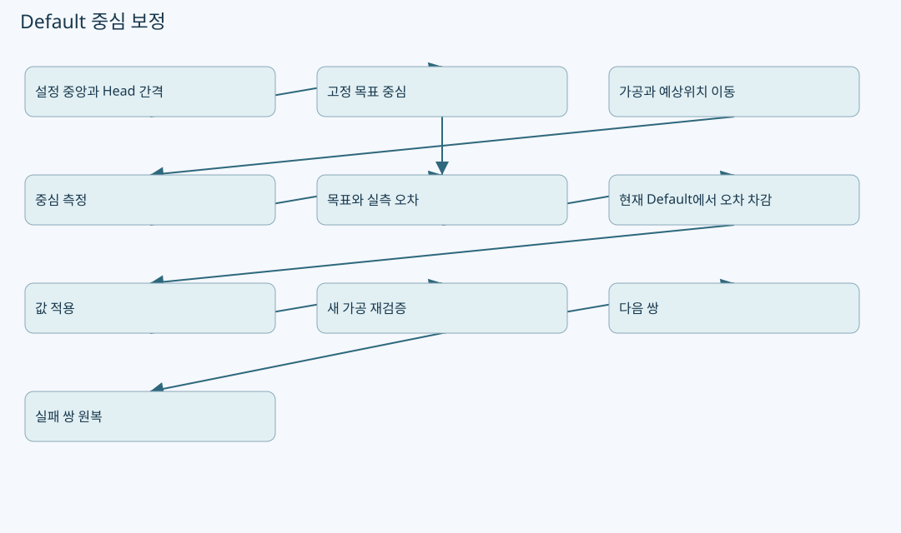
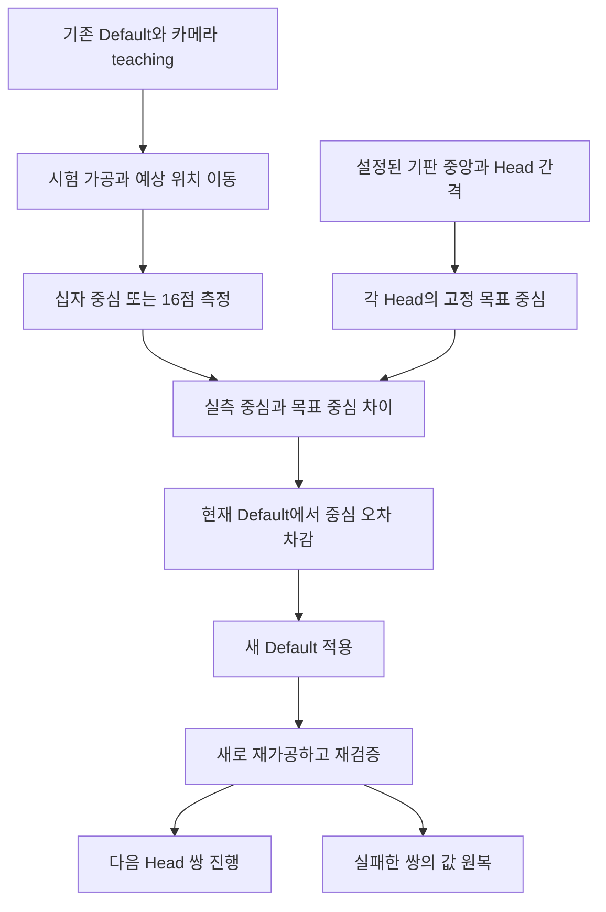

# Default Offset·Zero Order·First Beam: 중심 기준과 보정값의 역할




원본: `kjuws10-rgb/A3Drilling` · `master` · `5aee8e58439c9b455cae7c9593c9be986c3e682e`

이 장의 **코드 확인**은 해당 Commit의 실제 함수 본문을 정적으로 추적한 사실입니다. **해설**은 그 구조를 이해하기 위한 설명이며, **검증 과제**는 앞으로 실행할 시험입니다. 실장비의 부호·광학 상태·통신 타이밍·정밀도가 검증되었다는 뜻은 아닙니다. 예시 숫자는 설명용 가상값입니다.

## 1. 용어를 먼저 고정하기

이 장에서 **원빔**은 DOE가 없어서 16분기 Beam이 생기지 않고 실제 출사점이 Zero Order 위치가 되는 광학 상태를 말합니다. 프로그램에서 단지 BeamNo 하나를 선택했다고 DOE가 사라지거나 실제 빔이 한 개가 되는 것은 아닙니다. 현재 Default calibration의 Shot 측정 함수는 4×4 16점 격자를 전제로 하고, Cross 측정 함수는 Vision이 반환한 중심 한 점을 사용합니다. **Cross 모양과 DOE 유무는 별도 조건**입니다. [CDefaultOffsetCalibration.cs:107–171](https://github.com/kjuws10-rgb/A3Drilling/blob/5aee8e58439c9b455cae7c9593c9be986c3e682e/Drilling.Common/Correction/CDefaultOffsetCalibration.cs#L107-L171)

회의의 의도는 “Default는 Zero Order 기준으로 스캐너의 기본 위치를 맞추고, 원빔을 평가용 Beam11 위치에 맞추는 추가 이동은 별도 역할로 다루자”는 것입니다. 이 문단은 용어를 구분한 요구 설명이며, 현재 코드에 모든 원빔 자동 평가 경로가 구현되어 있다는 판정이 아닙니다. 구현에서 Default와 FirstBeam은 별도 키로 읽고 최종 좌표에서 더하는 독립 성분입니다. [CShotCoordinatePlanBuilder.cs:59–65](https://github.com/kjuws10-rgb/A3Drilling/blob/5aee8e58439c9b455cae7c9593c9be986c3e682e/Drilling.Common/Recipe/CShotCoordinatePlanBuilder.cs#L59-L65) [CShotCoordinatePlanBuilder.cs:139–155](https://github.com/kjuws10-rgb/A3Drilling/blob/5aee8e58439c9b455cae7c9593c9be986c3e682e/Drilling.Common/Recipe/CShotCoordinatePlanBuilder.cs#L139-L155)



## 2. 핵심 파일과 책임

| 파일 / 함수 | 책임 | 여기서 하지 않는 것 |
|---|---|---|
| `CDefaultOffsetCalibration.Conditions` | Recipe/Setting에서 중앙·시험 Stage Y·허용오차 구성 | live AK 두 점을 새로 촬영하지 않음. [CDefaultOffsetCalibration.cs:31–38](https://github.com/kjuws10-rgb/A3Drilling/blob/5aee8e58439c9b455cae7c9593c9be986c3e682e/Drilling.Common/Correction/CDefaultOffsetCalibration.cs#L31-L38) |
| `HeadGeometry`, `Slot`, `Fit` | scan field, DOE angle, 16점 격자 geometry | DOE의 실제 장착 여부를 광학적으로 검출하지 않음. [CDefaultOffsetCalibration.cs:41–50](https://github.com/kjuws10-rgb/A3Drilling/blob/5aee8e58439c9b455cae7c9593c9be986c3e682e/Drilling.Common/Correction/CDefaultOffsetCalibration.cs#L41-L50) [CDefaultOffsetCalibration.cs:107–160](https://github.com/kjuws10-rgb/A3Drilling/blob/5aee8e58439c9b455cae7c9593c9be986c3e682e/Drilling.Common/Correction/CDefaultOffsetCalibration.cs#L107-L160) |
| `WithHeadReference` | Head별 고정 목표와 encoder 기반 실측 중심 비교 | 직전 Head 측정 위치에서 다음 목표를 누적 생성하지 않음. [CDefaultOffsetCalibration.cs:175–201](https://github.com/kjuws10-rgb/A3Drilling/blob/5aee8e58439c9b455cae7c9593c9be986c3e682e/Drilling.Common/Correction/CDefaultOffsetCalibration.cs#L175-L201) |
| `Recommend` | 현재 Default에서 중심 오차를 빼서 새값 추천 | Head Flip을 여기서 다시 적용하지 않음. [CDefaultOffsetCalibration.cs:206–228](https://github.com/kjuws10-rgb/A3Drilling/blob/5aee8e58439c9b455cae7c9593c9be986c3e682e/Drilling.Common/Correction/CDefaultOffsetCalibration.cs#L206-L228) |
| `CMenuCorrection.RunDefaultPairs` | H4/5→H3/6→H2/7→H1/8 실행·검증 | 검증되지 않은 값을 성공으로 확정하지 않음. [CMenuCorrection.cs:3296–3393](https://github.com/kjuws10-rgb/A3Drilling/blob/5aee8e58439c9b455cae7c9593c9be986c3e682e/Drilling.UI/Menu/Menus/CMenuCorrection.cs#L3296-L3393) |
| `CShotCoordinatePlanBuilder` | Default·FirstBeam·Align·Review를 Scanner 축으로 합산 | Default와 FirstBeam을 같은 값으로 취급하지 않음. [CShotCoordinatePlanBuilder.cs:133–155](https://github.com/kjuws10-rgb/A3Drilling/blob/5aee8e58439c9b455cae7c9593c9be986c3e682e/Drilling.Common/Recipe/CShotCoordinatePlanBuilder.cs#L133-L155) |

## 3. H4/H5 ±55 mm와 110 mm 간격의 정확한 조건

현재 `WithHeadReference`가 사용하는 공식은 다음과 같습니다. [CDefaultOffsetCalibration.cs:184–189](https://github.com/kjuws10-rgb/A3Drilling/blob/5aee8e58439c9b455cae7c9593c9be986c3e682e/Drilling.Common/Correction/CDefaultOffsetCalibration.cs#L184-L189)

```text
BoardCenterX = REVIEW_CAMERA_ALIGN_KEY_POS_X + GLASS_SIZE_X / 2 − AK_MARGIN_X
TargetHeadX  = BoardCenterX + (HeadNo − 4.5) × HeadGapX
```

`HeadGapX=110 mm`인 가상 설정에서는 아래 상대 위치가 됩니다. 55/110이 계산 함수에 무조건 상수로 박혀 있는 것이 아니라 **HeadGapX가 110일 때**의 결과입니다.

| Head | 중앙 기준 X | 산식 |
|---|---:|---|
| H1 | −385 mm | (1−4.5)×110 |
| H2 | −275 mm | (2−4.5)×110 |
| H3 | −165 mm | (3−4.5)×110 |
| H4 | −55 mm | (4−4.5)×110 |
| H5 | +55 mm | (5−4.5)×110 |
| H6 | +165 mm | (6−4.5)×110 |
| H7 | +275 mm | (7−4.5)×110 |
| H8 | +385 mm | (8−4.5)×110 |

각 Head의 목표는 같은 BoardCenterX에 대해 독립적으로 계산됩니다. H4를 측정한 좌표에 −110을 더해 H3를 만들고 다시 −110을 더하는 방식이 아닙니다. 앞 Head의 측정 오차가 뒤 Head 기준에 누적되지 않도록 한 구조입니다. 소스 주석도 이전 측정 Head를 global reference로 삼지 않는다고 설명합니다. [CDefaultOffsetCalibration.cs:173–185](https://github.com/kjuws10-rgb/A3Drilling/blob/5aee8e58439c9b455cae7c9593c9be986c3e682e/Drilling.Common/Correction/CDefaultOffsetCalibration.cs#L173-L185)

### live Align Key 두 점의 평균과는 구별해야 한다

사용자가 말한 “AK 두 점의 중간을 직접 구한 뒤 ±55 mm”와 현재 공식은 **중앙 기준을 얻는 단계가 다릅니다.** 이 함수는 카메라 AK 설정값, GlassSizeX, AK margin으로 중앙을 구성합니다. live AK 두 점 X/Y 평균이나 `atan2(ΔY,ΔX)`의 회전각을 이 공식에서 계산하지 않습니다. Distortion의 AK/DK 수신 기능이 따로 있다고 해서 이 Default 중앙에 자동 연결되었다고 볼 수 없습니다. [CDefaultOffsetCalibration.cs:31–38](https://github.com/kjuws10-rgb/A3Drilling/blob/5aee8e58439c9b455cae7c9593c9be986c3e682e/Drilling.Common/Correction/CDefaultOffsetCalibration.cs#L31-L38) [CDefaultOffsetCalibration.cs:175–201](https://github.com/kjuws10-rgb/A3Drilling/blob/5aee8e58439c9b455cae7c9593c9be986c3e682e/Drilling.Common/Correction/CDefaultOffsetCalibration.cs#L175-L201) [CAlignInterpolation.cs:306–327](https://github.com/kjuws10-rgb/A3Drilling/blob/5aee8e58439c9b455cae7c9593c9be986c3e682e/Drilling.Common/Correction/CAlignInterpolation.cs#L306-L327)

**검토 과제:** live AK 기준으로 바꿀 경우에는 AK 측정 시각·GlassId·좌표 frame·2점 간 설계거리·회전각·허용오차를 함께 동결해야 합니다. 기판의 ΔY 기울기를 그대로 Scanner 고정 기준에 섞을지, 기판 회전을 먼저 정렬할지는 광학 고정축과 기판 좌표계를 분리해 결정해야 합니다. 이는 개선 설계 과제이며 현재 구현이라고 쓰지 않습니다.

## 4. 예상 위치와 목표 위치는 다르다

`MeasureDefaultCenter`는 카메라가 마크를 찾을 예상 위치를 기존 teaching과 **현재 Default**로 계산합니다. source comment는 이 teaching이 마크를 찾는 위치일 뿐 기판 중앙 기준의 목표 Head reference를 정의하지 않는다고 설명합니다. 적용 후 재검증에서 바뀐 마크 위치를 따라가기 위해 현재 Default를 더합니다. [CMenuCorrection.cs:3727–3735](https://github.com/kjuws10-rgb/A3Drilling/blob/5aee8e58439c9b455cae7c9593c9be986c3e682e/Drilling.UI/Menu/Menus/CMenuCorrection.cs#L3727-L3735)

```text
captureCenterX = cameraAK_X + H01_AK_POSITION_X
                 + (HeadNo−1)×HeadGapX + CurrentDefaultX
captureCenterY = test.Q − direction×gapY + direction×CurrentDefaultY
```

반면 최종 오차는 `WithHeadReference`에서 고정된 기판 중앙 기준 목표와 비교합니다. 카메라 예상 위치를 잘 맞추려고 teaching을 바꾼 일이 곧 목표 중앙을 바꾼 일이 되어서는 안 됩니다. 이 구분이 첫 빔 탐색과 calibration을 이해하는 핵심입니다. [CMenuCorrection.cs:3727–3764](https://github.com/kjuws10-rgb/A3Drilling/blob/5aee8e58439c9b455cae7c9593c9be986c3e682e/Drilling.UI/Menu/Menus/CMenuCorrection.cs#L3727-L3764) [CDefaultOffsetCalibration.cs:184–200](https://github.com/kjuws10-rgb/A3Drilling/blob/5aee8e58439c9b455cae7c9593c9be986c3e682e/Drilling.Common/Correction/CDefaultOffsetCalibration.cs#L184-L200)

## 5. 실측 중심은 encoder와 수신 보정을 이용한다

현재 `WithHeadReference`의 실제 계산은 아래와 같습니다. 단순히 Vision이 반환한 좌표 하나를 설계 절대좌표로 취급하지 않습니다. [CDefaultOffsetCalibration.cs:180–200](https://github.com/kjuws10-rgb/A3Drilling/blob/5aee8e58439c9b455cae7c9593c9be986c3e682e/Drilling.Common/Correction/CDefaultOffsetCalibration.cs#L180-L200)

```text
ActualX = Average(EncoderX − CorrectionX)
ActualY = Average(EncoderY − direction×CorrectionY)
TargetY = test.Q − direction×gapY
CenterErrorX = ActualX − TargetX
CenterErrorY = (ActualY − TargetY) / direction
```

입력은 Head1..8, 유한한 Q와 encoder/correction, Cross 한 점(Beam0) 또는 Beam1..16이 하나씩 있는 완전한 배열이어야 합니다. `Fit`에서는 모든 점 OK, 중복 없는16 Beam, 예상 격자와의 잔차 및 pitch/angle을 검증합니다. 일부 Beam이 안 보였는데 나머지 평균만으로 가상 중심을 임의 확정하는 분기는 이 함수에 없습니다. [CDefaultOffsetCalibration.cs:125–160](https://github.com/kjuws10-rgb/A3Drilling/blob/5aee8e58439c9b455cae7c9593c9be986c3e682e/Drilling.Common/Correction/CDefaultOffsetCalibration.cs#L125-L160) [CDefaultOffsetCalibration.cs:175–200](https://github.com/kjuws10-rgb/A3Drilling/blob/5aee8e58439c9b455cae7c9593c9be986c3e682e/Drilling.Common/Correction/CDefaultOffsetCalibration.cs#L175-L200)

## 6. Shot 16점과 Cross 한 점 경로

| 경로 | 현재 호출 | 모델 가정 / 제한 |
|---|---|---|
| Shot | beam1..16에 대해 Slot을 계산하고 각 Capture 후 `Fit` | `SPLITED_BEAM_COUNT`가4인4×4, 16점 완전 측정 필요 |
| Cross | beam0, localoffset0에서 한 Capture 후 `FitCross` | Vision이 반환한 십자 중심을 사용 |

Cross shape는 scanner가 그리는 형태입니다. DOE가 장착되어 있다면 그 형태도 물리적으로 여러 곳에 나뉠 수 있습니다. 따라서 **Cross=DOE 제거=원빔**이라는 동치는 성립하지 않습니다. 실제 Vision method가 어떤 마크의 중심을 반환하는지, DOE 장착 Scanner에서 가상 Zero Order를 어떻게 확정할지는 현장 광학/프로토콜 계약을 확인해야 합니다. [CMenuCorrection.cs:3740–3758](https://github.com/kjuws10-rgb/A3Drilling/blob/5aee8e58439c9b455cae7c9593c9be986c3e682e/Drilling.UI/Menu/Menus/CMenuCorrection.cs#L3740-L3758) [CDefaultOffsetCalibration.cs:107–171](https://github.com/kjuws10-rgb/A3Drilling/blob/5aee8e58439c9b455cae7c9593c9be986c3e682e/Drilling.Common/Correction/CDefaultOffsetCalibration.cs#L107-L171)

추천값은 `nextDefault = Round(currentDefault − CenterError,5,AwayFromZero)`이고 유한한 값, ±100 mm 범위를 확인합니다. 이 방향은 코드에서 확인한 산식이며 물리축을 추측해 정한 방향이 아닙니다. Head flip은 나중 Scanner builder에서 적용하므로 추천 단계에서 다시 반전하면 안 됩니다. [CDefaultOffsetCalibration.cs:206–228](https://github.com/kjuws10-rgb/A3Drilling/blob/5aee8e58439c9b455cae7c9593c9be986c3e682e/Drilling.Common/Correction/CDefaultOffsetCalibration.cs#L206-L228)

## 7. 실제 UI 쌍별 실행 순서와 실패 처리

`RunDefaultPairs`는 USE Head를 골라 `[4,5]`, `[3,6]`, `[2,7]`, `[1,8]` 순서로 묶습니다. 한쪽 Head가 미사용이면 남은 Head만 처리합니다. 각 쌍에서 **가공 → 검사 → 추천 → 적용 → 새 재가공 → 새 재검증**을 실행합니다. 기존 마크를 다시 측정한 것만으로 새 Default를 검증한 것으로 보지 않습니다. [CMenuCorrection.cs:3296–3358](https://github.com/kjuws10-rgb/A3Drilling/blob/5aee8e58439c9b455cae7c9593c9be986c3e682e/Drilling.UI/Menu/Menus/CMenuCorrection.cs#L3296-L3358)

각 Head의 재검증 X/Y 오차가 허용오차 이내일 때 해당 쌍을 Verified로 확정하고 다음 쌍으로 넘어갑니다. 실패·취소하면 아직 검증되지 않은 해당 쌍의 적용 전 값을 복원합니다. 앞에서 검증한 쌍은 유지합니다. 복원도 실패하면 원래 실패와 restore 오류를 AggregateException으로 보고합니다. “전체 자동 원복”과 “실패 쌍만 원복”을 구별해야 합니다. [CMenuCorrection.cs:3357–3393](https://github.com/kjuws10-rgb/A3Drilling/blob/5aee8e58439c9b455cae7c9593c9be986c3e682e/Drilling.UI/Menu/Menus/CMenuCorrection.cs#L3357-L3393)

측정에 들어가기 전에는 Laser Off 명령을 내리고, 해당 요청 이후에 갱신된 신선한 축 snapshot에서 raw output0을 확인합니다. timeout은5초이며 offline/error도 실패합니다. 다만 이 확인 로직의 존재가 하드웨어 안전 회로나 실제 레이저 차단 성능의 검증을 대신하지 않습니다. [CMenuCorrection.cs:3702–3726](https://github.com/kjuws10-rgb/A3Drilling/blob/5aee8e58439c9b455cae7c9593c9be986c3e682e/Drilling.UI/Menu/Menus/CMenuCorrection.cs#L3702-L3726)

## 8. Default와 FirstBeam이 합쳐지는 지점

builder는 Head마다 `Hnn_DEFAULT_OFFSET_X/Y`와 `Hnn_FIRST_BEAM_OFFSET_X/Y`를 별도로 읽습니다. 두 값은 design Y→Stage Y 변환과 Head transform을 거쳐 독립적으로 Scanner offset이 됩니다. 여기에 Recipe/Review/Align 성분을 더해 final scanner 좌표를 만듭니다. Align/Review scale은 이번 기여값에만 곱하고 저장값은 바꾸지 않는 주석도 있습니다. [CShotCoordinatePlanBuilder.cs:59–65](https://github.com/kjuws10-rgb/A3Drilling/blob/5aee8e58439c9b455cae7c9593c9be986c3e682e/Drilling.Common/Recipe/CShotCoordinatePlanBuilder.cs#L59-L65) [CShotCoordinatePlanBuilder.cs:133–155](https://github.com/kjuws10-rgb/A3Drilling/blob/5aee8e58439c9b455cae7c9593c9be986c3e682e/Drilling.Common/Recipe/CShotCoordinatePlanBuilder.cs#L133-L155)

**해설:** Default를 기본 기하 정렬에, FirstBeam을 실제 패턴 위치의 추가 이동에 쓰겠다는 운영 개념을 유지하려면 두 값의 목적·획득 절차·적용 시점을 UI에서 분리해야 합니다. 원빔을 평가용 Beam11 위치로 옮길 양을 Default에 섞어 넣으면 다음에 Zero Order 중심 calibration을 할 때 기본 기준과 평가 이동량이 혼합됩니다. 현재 builder의 독립 키를 유지한 채 Head별 광학 mode와 유효 Beam 정책을 함께 검증하는 편이 명확합니다.

## 9. 검증 과제

| 항목 | 가상 / 실장비 확인 방법 | 통과 판단 |
|---|---|---|
| ±55/110 | HeadGapX110, 중앙 가상값으로 H1..8 계산 | 위 상대 위치 표와 일치 |
| 독립 기준 | H4 실측만 일부러 크게 변경 | H3 목표 기준은 변하지 않음 |
| AK 기울기 | live AK ΔY를 바꾼 입력과 현재 Default 조건 비교 | 현재 경로에는 live2점 회전 자동 반영이 없음을 명확히 표시 |
| currentDefault 포함 | Default가 0이 아닌 상태에서 첫 capture와 재검증 | capture 예상 위치가 변경값을 따라가고 목표 중앙은 고정 |
| 불완전16점 | 15점·중복Beam·NG·NaN | 추천 전 거부 |
| DOE 없음 | 원빔 optical mode와 한 점 측정 계약 확인 | 16점 경로를 강제로 성공 처리하지 않음 |
| Cross+DOE | 실제16개십자 중 Vision이 찾는 중심 확인 | software mode만으로 원빔이라 단정하지 않음 |
| 쌍별 중단 | H3/6 적용 직후 실패 주입 | H3/6만 원복, H4/5 Verified 유지 |
| 방향 검증 | 작은 ±X/±Y 입력, 모든 Head flip | 실제 이동이 식과 일치하며 이중 반전 없음 |

Pure 계산 시험은 설비 없이 먼저 할 수 있습니다. 첫 빔 탐색·DOE 실제 구성·십자 중심 검출은 카메라와 광학 실물 확인이 필요한 별도 시험입니다. 본 문서에서는 실행하지 않았습니다.
