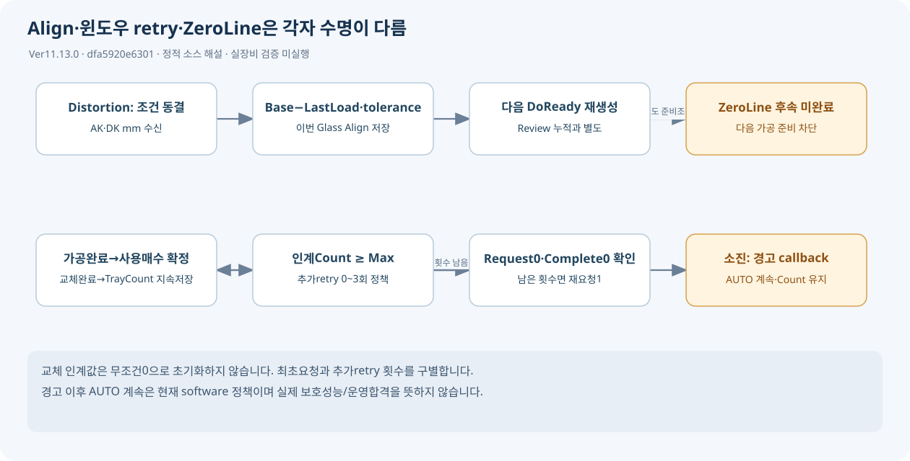
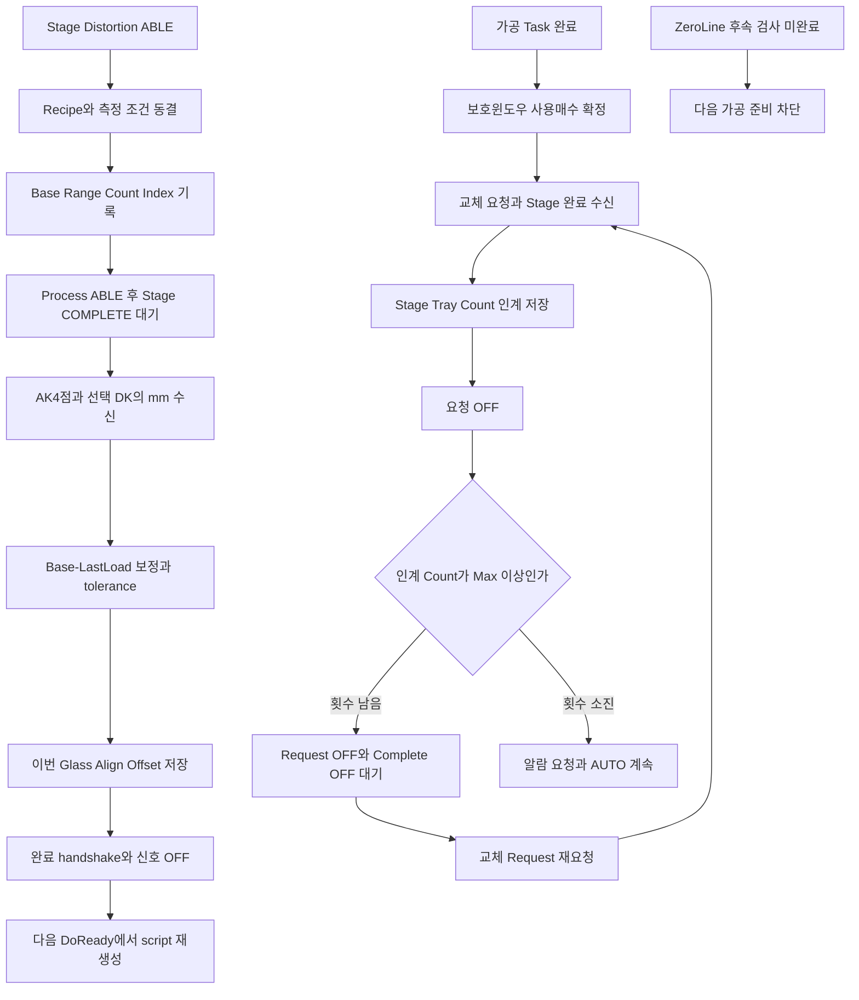

# Align·Distortion·보호윈도우·복구: 자동 시퀀스의 데이터 경계

> 최신 원본 기준: **2026-11-25 · master Ver11.23.0 · `0219666f9053b907d96d7e0aa7d0c6c1be3a73d4`**. 이전 버전의 변경 설명은 연혁으로 보존하며, 이번 Stage Glass Data·Product 필드 변경은 [Stage Glass 상세장](../architecture/10-stage-glass-data-and-product-fields.md)에서 다룹니다.

원본: `kjuws10-rgb/A3Drilling` · `master` · `0219666f9053b907d96d7e0aa7d0c6c1be3a73d4`

이전 정적 검토 기록: **11.19.0 / 2026-11-20**, 비교 기준 11.17.0(`96e22cd027c84bf302b23f2949b98985d7f301bb`). 11.18/11.19 두 Commit의 변경과 이전부터 남아 있는 경계를 함께 확인했습니다. 아래 변경 항목과 기존 잔건을 구분합니다. 파일·함수·호출 경계의 정적 확인이며 장비 실행 시험 결과가 아닙니다.

이 장의 **코드 확인**은 해당 Commit의 실제 함수 본문을 정적으로 추적한 사실입니다. **해설**은 그 구조를 이해하기 위한 설명이며, **검증 과제**는 앞으로 실행할 시험입니다. 실장비의 부호·광학 상태·통신 타이밍·정밀도가 검증되었다는 뜻은 아닙니다. 예시 숫자는 설명용 가상값입니다.

## 1. 이 장의 범위

이 장은 Distortion의 AK/DK 수신→Align Offset 계산→다음 DoReady 연결, 수동 Wapage Load/Set의 구분, 보호윈도우 사용매수 handover, ZeroLine 후속검사와 다음 가공 차단을 추적합니다. 모든 A1 알람의 정지·재개 알고리즘이나 실제 광학 회복 성공을 판정하는 장은 아닙니다. 그런 결론에는 Task 정지 확인, 레이저 차단, Stage 정지, 보정 유효성, Glass 처리방침을 추가로 검증해야 합니다.

## 2. Distortion이 동결하는 것

`CAlignDistortionCycle.Prepare`는 이전 snapshot/pending/results/model/offsets와 저장 플래그를 초기화하고, 현재 요청의 RecipeId로 Recipe를 새로 읽습니다. Motor의 Stage Y 위치, Run Option의 Distortion group, Align Offset tolerance, Align camera resolution, Wapage 허용 mm 범위를 확보합니다. `pixels = rangeMm / resolution`이며 분해능은 양수, range는0이상이어야 합니다. [CAlignInterpolation.cs:276–293](https://github.com/kjuws10-rgb/A3Drilling/blob/0219666f9053b907d96d7e0aa7d0c6c1be3a73d4/Drilling.Common/Correction/CAlignInterpolation.cs#L276-L293)

조건만 읽는 것으로 끝나지 않습니다. 필요한 모든 MELSEC route의 주소·USE·자료형·방향·연결 상태를 **첫 PLC write 전에 검증**합니다. Vision fine-align 결과8값을 읽어 Base에 쓰고, Range pixel을 쓰며, Distortion Count/Index/Stage Y 위치도 기록합니다. viewer snapshot에는 측정 표시와 무관한 Shot offset/history를 빼는 최적화 주석이 있습니다. [CAlignInterpolation.cs:294–320](https://github.com/kjuws10-rgb/A3Drilling/blob/0219666f9053b907d96d7e0aa7d0c6c1be3a73d4/Drilling.Common/Correction/CAlignInterpolation.cs#L294-L320)

| 자료 | source의 의미 | 잘못 이해하기 쉬운 점 |
|---|---|---|
| `ALIGNBASE_AKn_X/Y` | Recipe에 저장한 Align 기준값 | 매번 자동으로 현재 측정값으로 overwrite하는 일반 설정값이 아님 |
| `DISTORTION_POS0_CAMnX/Y` | AK1..4의 현재 측정 결과 map | Vision TCP1001 식별자 body와 다른 MELSEC 경로 |
| DK result map | 선택 group의 CAM2/CAM4와 Stage 위치 결과 | 모든 DK를 항상 측정한다고 가정하지 않기 |
| Range | mm 허용범위를 camera resolution으로 나눈 pixel | global mm좌표와 단위가 다름 |
| Align Shot Offset | Base−LastLoad로 계산한 설계 좌표 보정 | Review 보정 파일과 별도 |

AK와 DK result ID mapping은 `ResultId`에서 명시합니다. AK1..4는 POS0/CAM1..4, DK는 group과 CAM2/4로 매핑합니다. [CAlignInterpolation.cs:247–261](https://github.com/kjuws10-rgb/A3Drilling/blob/0219666f9053b907d96d7e0aa7d0c6c1be3a73d4/Drilling.Common/Correction/CAlignInterpolation.cs#L247-L261)

## 3. Distortion handshake의 실제 순서

`RunDistortion`은 소유한 Process output을0으로 만들고 Stage Complete0을 확인합니다. 그 뒤 Prepare로 조건을 동결하고 다시 Stage Complete0을 확인합니다. `readyAt`을 잡은 후 Process Able1을 쓰고 그 이후의 Stage Complete1을 기다립니다. 이전 사이클의 stale 완료 신호를 현재 응답으로 취급하지 않으려는 순서입니다. [CStationProcess.cs:5775–5792](https://github.com/kjuws10-rgb/A3Drilling/blob/0219666f9053b907d96d7e0aa7d0c6c1be3a73d4/Drilling.Common/Station/CStationProcess.cs#L5775-L5792)

Stage 완료 후 Load→Calculate→Save를 성공해야 Process Complete1을 보냅니다. Stage Complete0 및 Able0을 확인한 다음에 Process outputs를0으로 내립니다. `_distortionNeedsDoReady=true`를 설정하며 로그에도 다음 요청에서 DoReady script 재생성이 필요하다고 남깁니다. 측정이 끝났다고 기존 가공 script를 그대로 써도 된다는 구조가 아닙니다. [CStationProcess.cs:5790–5810](https://github.com/kjuws10-rgb/A3Drilling/blob/0219666f9053b907d96d7e0aa7d0c6c1be3a73d4/Drilling.Common/Station/CStationProcess.cs#L5790-L5810)

## 4. AK4점 글로벌 mm 수동 수신과 자동 보정의 구분

현재 코드에 **버튼 기반 one-shot 수신/기록 서비스**가 존재합니다. `CAlignWapageService.Load`는 Vision의 `SVID_FINEALN_CAM1..4_GLS_RESULT_X/Y`8개 값과 Process 쪽 Base/Range를 함께 읽습니다. 수신 숫자는 `CMelsec`에서 READ_SCALE이 적용된 값이고 nonfinite면 거부합니다. 이 service의 Load는 SetBase/SetRange와 분리되어 있어 읽기만 했다고 write하지 않습니다. [CAlignInterpolation.cs:382–393](https://github.com/kjuws10-rgb/A3Drilling/blob/0219666f9053b907d96d7e0aa7d0c6c1be3a73d4/Drilling.Common/Correction/CAlignInterpolation.cs#L382-L393) [CAlignInterpolation.cs:426–455](https://github.com/kjuws10-rgb/A3Drilling/blob/0219666f9053b907d96d7e0aa7d0c6c1be3a73d4/Drilling.Common/Correction/CAlignInterpolation.cs#L426-L455)

그러나 **현재 map에 있는 값을 읽기**와 **지금 새로 Align 측정을 요청해 특정 Glass의 최신4점 global mm를 얻기**는 다른 기능입니다. 이 Load 함수는 새로운 측정 START/COMPLETE를 발행하지 않습니다. Distortion의 `LoadResults`는 별도 result map을 읽어 `ALIGNBASE_*` 키로 매핑하고 LoadedAt을 기록합니다. 두 source의 주소·소유자·단위·갱신시점이 같다고 임의로 가정하면 안 됩니다. [CAlignInterpolation.cs:322–332](https://github.com/kjuws10-rgb/A3Drilling/blob/0219666f9053b907d96d7e0aa7d0c6c1be3a73d4/Drilling.Common/Correction/CAlignInterpolation.cs#L322-L332) [CAlignInterpolation.cs:426–436](https://github.com/kjuws10-rgb/A3Drilling/blob/0219666f9053b907d96d7e0aa7d0c6c1be3a73d4/Drilling.Common/Correction/CAlignInterpolation.cs#L426-L436)

**개선 검토:** 사용자가 원하는 “언제든 AK4점 글로벌 X/Y(mm) 수동 수신” 화면은 최소한 source=현재값 읽기인지 새측정 요청인지, GlassId, 측정시각, 수신시각, 유효/NG,8개 좌표, 이전값과의 차이, 보정 반영 여부를 구분해야 합니다. 읽기 버튼이 즉시 Base를 덮어쓰지 않도록 현재 service의 분리 원칙을 유지하는 것이 좋습니다. 이는 UI 요구 해설이며 이 모든 항목의 구현 완료를 주장하지 않습니다.

## 5. Base, Range를 수동으로 쓰는 경계

`SetBase`는 Vision source8값이 전부 유한해야 쓰고, `SetRange`는0이상 유한 pixel이어야 씁니다. destination 순서는 CAM1..4 X→X1..4 다음 CAM1..4 Y→Y1..4입니다. 소스에 기록된 이 순서를 X1,Y1,X2,Y2와 혼동하면 좌표가 뒤섞입니다. [CAlignInterpolation.cs:385–393](https://github.com/kjuws10-rgb/A3Drilling/blob/0219666f9053b907d96d7e0aa7d0c6c1be3a73d4/Drilling.Common/Correction/CAlignInterpolation.cs#L385-L393) [CAlignInterpolation.cs:451–460](https://github.com/kjuws10-rgb/A3Drilling/blob/0219666f9053b907d96d7e0aa7d0c6c1be3a73d4/Drilling.Common/Correction/CAlignInterpolation.cs#L451-L460)

write 전에는 `WriteScale`로 정수 저장범위를 확인하고 readback 예상값을 계산합니다. 실제 `_write`에는 논리값을 넘겨 CMelsec에서 scale을 한 번만 적용하게 합니다. 모든 값 기록 후 readback과1e−7 기준으로 비교합니다. 일부 write 후 실패하면 “몇 개 쓰기 완료했으며 일부 변경됐을 수 있으니 Load로 확인”하는 오류를 냅니다. **이 write 묶음은 모든 PLC값이 원자적으로 한 번에 바뀌는 트랜잭션이 아닙니다.** [CAlignInterpolation.cs:462–493](https://github.com/kjuws10-rgb/A3Drilling/blob/0219666f9053b907d96d7e0aa7d0c6c1be3a73d4/Drilling.Common/Correction/CAlignInterpolation.cs#L462-L493)

## 6. Base−LastLoad가 Align Offset이 되는 과정

`Keys`는 Recipe의 Base에서 수신 measured를 빼 `CorrectionX/Y`를 만듭니다. `Calculate`는 AK와 선택 DK로 `CAlignInterpolation` 모델을 만들고 Shot별 Align Offset을 구합니다. tolerance를 넘는 Shot이 하나라도 있으면 전체 적용을 취소합니다. [CAlignInterpolation.cs:268–273](https://github.com/kjuws10-rgb/A3Drilling/blob/0219666f9053b907d96d7e0aa7d0c6c1be3a73d4/Drilling.Common/Correction/CAlignInterpolation.cs#L268-L273) [CAlignInterpolation.cs:334–344](https://github.com/kjuws10-rgb/A3Drilling/blob/0219666f9053b907d96d7e0aa7d0c6c1be3a73d4/Drilling.Common/Correction/CAlignInterpolation.cs#L334-L344)

`Save`는 필요한 모델과 결과가 모두 준비되어야 합니다. `SaveAlignOffsetsIfUnchanged`로 Recipe 변경 여부를 고려한 저장을 수행하고, key별 Base/LastLoad/correction 및 계산 offset audit를 남깁니다. 이번 요청의 기존 Align offset key를 제거하고 저장된 Align offset을 넣은 pending request를 만듭니다. `TakePreparedRequest`는 같은 RecipeId만 허용하며 pending을 한 번 가져가도록 합니다. [CAlignInterpolation.cs:346–377](https://github.com/kjuws10-rgb/A3Drilling/blob/0219666f9053b907d96d7e0aa7d0c6c1be3a73d4/Drilling.Common/Correction/CAlignInterpolation.cs#L346-L377)

**해설:** 오래 저장된 Review Offset 누적과 이번 Glass Align Offset 갱신은 다른 수명 주기입니다. 동시에 합산된다고 둘을 같은 파일로 관리하거나 동일한 rollback 버튼으로 지우면 운영 의미가 달라집니다. 최종 builder에서는 Align과 Review를 각자 변환하고 각자 scale을 적용한 뒤 합산합니다. [CShotCoordinatePlanBuilder.cs:141–156](https://github.com/kjuws10-rgb/A3Drilling/blob/0219666f9053b907d96d7e0aa7d0c6c1be3a73d4/Drilling.Common/Recipe/CShotCoordinatePlanBuilder.cs#L141-L156)

## 7. 보호윈도우 사용매수의 소유권

가공 Task가 모두 완료된 뒤 `CountCompletedProtectWindowGlass`는 Recipe의 사용매수를 증가시킵니다. gate와 `_protectWindowCounted`로 한 번만 확정합니다. 주석에는 이 시점 뒤 STOP·결과 저장 실패·Stage ACK가 와도 레이저 사용 사실이 없어지지 않으므로 durable count commit을 끝낸다고 설명합니다. 따라서 “Product CSV 저장 실패니까 사용매수도 자동 원복”으로 처리하면 실제 사용량을 잃을 수 있습니다. [CStationProcess.cs:3770–3791](https://github.com/kjuws10-rgb/A3Drilling/blob/0219666f9053b907d96d7e0aa7d0c6c1be3a73d4/Drilling.Common/Station/CStationProcess.cs#L3770-L3791)

`CProtectWindowUsageRequest.Update`는 Recipe의 Current/Maximum count를 읽고 Process count를 전송합니다. Current>=Maximum이면 교체 요청을 올립니다. Max0은 즉시 요청 조건이며 같은 Glass cycle에서 이미 교체 완료한 경우 다시 요청하지 않도록 acknowledged cycle을 검사합니다. [CStationProcess.cs:4388–4461](https://github.com/kjuws10-rgb/A3Drilling/blob/0219666f9053b907d96d7e0aa7d0c6c1be3a73d4/Drilling.Common/Station/CStationProcess.cs#L4388-L4461)

| logical ID | 뜻 | 책임 |
|---|---|---|
| `PROCESS_SEQUENCE_PTW_PROCESS_COUNT` | Process가 보고하는 사용매수 | Recipe 지속값과 연계 |
| `PROCESS_SEQUENCE_TPD_PTW_EXCHANGE_FLAG` | Process 교체 요청 | 요청 유지/해제 |
| `PTW_EXCHANGE_SEQ_COMPLETE` | Stage 교체 완료 | Stage가 인계 준비했는지 판단 |
| `PTW_TRAY_COUNT` | Stage가 인계하는 공식 사용매수 | 완료 수신 시 읽어 지속 저장 |

이 표는 logical ID 기준입니다. 실제 address, scale, 방향은 장비에 배포한 map을 별도로 확인해야 합니다. [CStationProcess.cs:4388–4419](https://github.com/kjuws10-rgb/A3Drilling/blob/0219666f9053b907d96d7e0aa7d0c6c1be3a73d4/Drilling.Common/Station/CStationProcess.cs#L4388-L4419)

## 8. 교체 완료 때 무조건0으로 만들지 않는다

완료 감시 코드는 이미 켜진 Request가 앱 재시작 후 남아 있거나 Monitor에서 발생한 경우도 pending Recipe를 잡는 경로가 있습니다. Complete false를 관찰하면 completion을 arm하고, Complete true와 armed 조건이 충족되면 Stage의 Tray Count를 읽습니다. **모든 교체/shift를 새 보호윈도우0매로 가정하지 않습니다.** [CStationProcess.cs:4687–4718](https://github.com/kjuws10-rgb/A3Drilling/blob/0219666f9053b907d96d7e0aa7d0c6c1be3a73d4/Drilling.Common/Station/CStationProcess.cs#L4687-L4718)

순서는 Stage count 읽기→`SetProtectWindowCount`로 Recipe에 지속 저장→Process count 보고→Request0입니다. `_committedHandoverCount`를 보관하므로 뒤쪽 보고/요청 해제 재시도 때 이미 확정한 인계 매수를 다시 읽어 바꾸지 않도록 구성합니다. 완료 전후의 다른 장애를 넣어 이 순서가 유지되는지 시험해야 합니다. [CStationProcess.cs:4708–4756](https://github.com/kjuws10-rgb/A3Drilling/blob/0219666f9053b907d96d7e0aa7d0c6c1be3a73d4/Drilling.Common/Station/CStationProcess.cs#L4708-L4756)

**11.13.0의 새 retry 정책:** Recipe의 PROTECT_WINDOW_RETRY_COUNT는 빈 값이면0, 정수0~3입니다. 의미는 최초 교체요청 외에 추가로 요청할 수 있는 횟수입니다. Stage가 인계한 TrayCount가 Maximum 이상이면 Request를0으로 확인한 뒤 추가시도 횟수를 올리고 Complete OFF를 기다립니다. Request와 Complete가 모두OFF일 때만 다음 Request1을 보내고 새로운 완료를 받습니다. 기존 Complete1을 다시 소비하는 반복이 아닙니다. [CRecipeManager.cs:428–452](https://github.com/kjuws10-rgb/A3Drilling/blob/0219666f9053b907d96d7e0aa7d0c6c1be3a73d4/Drilling.Common/Managers/CRecipeManager.cs#L428-L452) [CStationProcess.cs:4659–4673](https://github.com/kjuws10-rgb/A3Drilling/blob/0219666f9053b907d96d7e0aa7d0c6c1be3a73d4/Drilling.Common/Station/CStationProcess.cs#L4659-L4673) [CStationProcess.cs:4722–4756](https://github.com/kjuws10-rgb/A3Drilling/blob/0219666f9053b907d96d7e0aa7d0c6c1be3a73d4/Drilling.Common/Station/CStationProcess.cs#L4722-L4756)

횟수를 모두 쓰고도 인계 count가 Max 이상이면 해당 cycle을 acknowledged로 처리하고 pending을 지운 뒤 PROTECT_WINDOW_RETRY_EXHAUSTED callback을 호출합니다. 로그는 LIGHT alarm requested/AUTO continues라고 남깁니다. CManager는 WARNING 로그와 SetAlarm을 호출하므로 실제 배포 Alarm 정의의 LIGHT 수준도 함께 확인해야 합니다. 이 실패는 자동으로 사용 count를0으로 바꾸거나 이번 코드가 직접 AUTO HEAVY 중지하는 분기가 아닙니다. [CStationProcess.cs:4740–4756](https://github.com/kjuws10-rgb/A3Drilling/blob/0219666f9053b907d96d7e0aa7d0c6c1be3a73d4/Drilling.Common/Station/CStationProcess.cs#L4740-L4756) [CStationProcess.cs:4787–4796](https://github.com/kjuws10-rgb/A3Drilling/blob/0219666f9053b907d96d7e0aa7d0c6c1be3a73d4/Drilling.Common/Station/CStationProcess.cs#L4787-L4796) [CManager.cs:146–151](https://github.com/kjuws10-rgb/A3Drilling/blob/0219666f9053b907d96d7e0aa7d0c6c1be3a73d4/Drilling.Common/Managers/CManager.cs#L146-L151)

동일 Glass cycle의 acknowledged 검사가 있으므로 소진 직후 같은 cycle의 Update가 무조건 재요청하지 않습니다. 다만 새cycle, 앱 재시작, Monitor 수동요청에서의 시도계수 수명·정책 재로드를 각각 시험해야 합니다. retry counter는 이 객체의 메모리에 있으며 외부 영구시도 ID를 저장하는 구현으로 읽으면 안 됩니다. 평탄NG·교체NG의 상세한 장치별 원인정책과 현장 승인까지 이 문서로 확정하지 않습니다. [CStationProcess.cs:4402–4412](https://github.com/kjuws10-rgb/A3Drilling/blob/0219666f9053b907d96d7e0aa7d0c6c1be3a73d4/Drilling.Common/Station/CStationProcess.cs#L4402-L4412) [CStationProcess.cs:4443–4461](https://github.com/kjuws10-rgb/A3Drilling/blob/0219666f9053b907d96d7e0aa7d0c6c1be3a73d4/Drilling.Common/Station/CStationProcess.cs#L4443-L4461) [CStationProcess.cs:4687–4698](https://github.com/kjuws10-rgb/A3Drilling/blob/0219666f9053b907d96d7e0aa7d0c6c1be3a73d4/Drilling.Common/Station/CStationProcess.cs#L4687-L4698)

## 9. ZeroLine 후속검사가 남았을 때 다음 가공 차단

`EnsureZeroLineFollowUpCompleted`는 후속 cleanup이 남은 cycle이 있으면 다음 준비를 차단합니다. 후속검사가 요청된 경우에는 Stage Review 시퀀스 완료를 요구하고, 요청 출력 OFF 확인이 남은 경우에는 RESET으로 W8218 OFF 확인을 요구하는 오류를 냅니다. 다음 요청으로 ProcessModel을 바꾸기 전에 이전 Glass의 진단 Review 식별자를 보존하는 주석과 함께 호출됩니다. [CStationProcess.cs:4039–4050](https://github.com/kjuws10-rgb/A3Drilling/blob/0219666f9053b907d96d7e0aa7d0c6c1be3a73d4/Drilling.Common/Station/CStationProcess.cs#L4039-L4050) [CStationProcess.cs:4312–4320](https://github.com/kjuws10-rgb/A3Drilling/blob/0219666f9053b907d96d7e0aa7d0c6c1be3a73d4/Drilling.Common/Station/CStationProcess.cs#L4312-L4320)

AUTO Review handshake도 Prepare→Able→StageStart→ProcessStart→Measure→Save→ProcessComplete→StageComplete→신호정리 순서입니다. ZeroLine 후속1줄은 보정 미적용, 일반 AUTO는 전체OK일 때 다음 Glass 보정 저장이라는 목적 구분이 시퀀스 설명에도 들어갑니다. [CStationProcess.cs:5851–5875](https://github.com/kjuws10-rgb/A3Drilling/blob/0219666f9053b907d96d7e0aa7d0c6c1be3a73d4/Drilling.Common/Station/CStationProcess.cs#L5851-L5875)

**주의:** 이것은 “A1 가공 도중 임의 알람 발생 후 0선만 찍으면 기판 복구 성공”을 보장하는 코드가 아닙니다. 알람이 발생한 Task별 가공 완료 범위, 중단 위치, 레이저 사용량, 생성된 마크의 유효성, Stage handshake 잔류, 보정 파일 적용 상태를 각각 확인해야 합니다. 한 진단 결과를 전체 가공 성공과 동치로 만들지 않습니다.

## 10. 현장 전 검증 시나리오

| 순서 / 실패 주입 | 관찰 자료 | 기대 기준 |
|---|---|---|
| Distortion 시작 전 Complete가 이미1 | fresh signal / readyAt | 오래된 완료값만으로 Load하지 않음 |
| AK 한 route UNASSIGNED | Validate와 PLC write 수 | 첫 write 전 실패 |
| Camera resolution0 / mm range음수 | Prepare 예외 | 픽셀 범위 계산 중단 |
| AK/DK NaN 또는 일부 미수신 | Load/Calculate | 보정 저장·Complete 발행 중단 |
| Shot Align tolerance 초과 | ExceededShots / Recipe | 전체 적용 취소, 부분 갱신 없음 |
| Base 8개 중간 write 실패 | completed count / readback | 부분 변경 가능 경고, Load로 확인 |
| 가공 Task 완료 직후 STOP | 사용매수 지속값 | 레이저 사용 count 한 번 확정 |
| 교체 Complete 뒤 TrayCount가0이 아님 | Recipe count / Process count | Stage 공식값 보존 |
| count 저장 성공 후 Request0 실패 | committed count / 재시도 | 이미 확정한 count 유지하고 마무리 재시도 |
| 앱 재시작에 Request1 잔류 | pending recovery / Complete edge | 무조건 무시하거나 자동0으로 지우지 않음 |
| ZeroLine 후속 미완료에서 새 Glass | 오류와 ProcessModel | 이전 Glass 상태 보존, 다음 준비 차단 |
| retry0/1/3, 인계Count=Max | Request/Complete edge·issued count | 최초+추가횟수로 제한, 기존Complete 재사용 금지 |
| 추가요청 대기 중 Complete1 유지 | Request=0·Complete=1 | Complete0 전 재요청 금지 |
| retry 소진 | Callback·알람정의·AUTO 상태 | count 보존, pending정리, 경고 정책과 실제 운전방침 대조 |
| retry 도중 앱 재시작 | 복구pending·메모리counter | 영구시도계보 없음의 영향을 별도 확인 |

이 표는 mock MELSEC·fake Recipe 저장소·시뮬레이션 시퀀스로 먼저 검증하고, 이후 현장에서 상대 Stage/Vision과 재평가할 항목입니다. 장비의 알람 복구 완료나 보호 성능을 이 문서로 인증하지 않습니다.

## 11. 이번 변경에서 유지된 계약과 보간 잔건

이전 11.17 분석에서는 Distortion·Align 파일·보호윈도우 시퀀스 본문 변경이 없었습니다. 현재 두 Commit은 Distortion의 AK Margin 입력·snapshot을 Setting으로 통일하고 보호 주석을 보완합니다. 보호윈도우 retry 정책이나 새 L1~L4가 I/F 자체를 바꿨다고 확장하지 않습니다. Distortion은 Base−LastLoad(global mm)를 설계 key 위치에 놓고 X선형 후 Y Lagrange로 Align Offset을 만듭니다. Fine의 Cell/X열 Y 보간과 입력·저장·소비 경계가 다릅니다.

AK1~4·DK1~6은 수신 key 번호이고 Distortion Group은0~2입니다. COMPLETE가 최신 이번 Glass 데이터를 보장하는지는 I/F 검증 과제이며 유한값 확인만으로 freshness를 입증하지 않습니다. 저장 성공과 audit 실패가 한 원자 transaction이 아닌 경계, Range/측정값 신선도 확인은 기존 후속 시험입니다.

시험은 무DK/일부DK/세Group, 축·단위·부호, 손실 응답·지난 COMPLETE 잔류·audit 실패를 나눕니다. 이 절은 새 결함 주장이 아닌 기존 전체 흐름의 최신 재연결 설명입니다.

보간·수신·저장 경계: [CAlignInterpolation.cs:9–109](https://github.com/kjuws10-rgb/A3Drilling/blob/0219666f9053b907d96d7e0aa7d0c6c1be3a73d4/Drilling.Common/Correction/CAlignInterpolation.cs#L9-L109) [CAlignInterpolation.cs:322–365](https://github.com/kjuws10-rgb/A3Drilling/blob/0219666f9053b907d96d7e0aa7d0c6c1be3a73d4/Drilling.Common/Correction/CAlignInterpolation.cs#L322-L365)

## 12. Distortion과 ZeroLine의 AK Margin 동결

Distortion `Prepare`는 Recipe·DK그룹·Motor StageY·Tolerance와 함께 Option의 AK Margin을 동결하고 snapshot에 `AlignKeyMargins`를 보관합니다. `CAlignKeyGeometry.Create`는 Setting Margin으로 AK 설계 위치를, Motor StageY로 DK 위치를 만듭니다. `CAlignShotOffsetData.Calculate/ZeroValues`도 명시적 Margin을 받아 Recipe의 옛 Margin 대신 설계계산 맵에 주입합니다. [CAlignInterpolation.cs:191–215](https://github.com/kjuws10-rgb/A3Drilling/blob/0219666f9053b907d96d7e0aa7d0c6c1be3a73d4/Drilling.Common/Correction/CAlignInterpolation.cs#L191-L215) [CAlignInterpolation.cs:276–318](https://github.com/kjuws10-rgb/A3Drilling/blob/0219666f9053b907d96d7e0aa7d0c6c1be3a73d4/Drilling.Common/Correction/CAlignInterpolation.cs#L276-L318) [CShotCoordinatePlanBuilder.cs:717–733](https://github.com/kjuws10-rgb/A3Drilling/blob/0219666f9053b907d96d7e0aa7d0c6c1be3a73d4/Drilling.Common/Recipe/CShotCoordinatePlanBuilder.cs#L717-L733)

ZeroDefenceRecipePlan도 같은 Setting Margin을 보관하고 Beam의 Review축 위치를 다시 Glass 설계 위치로 옮길 때 사용합니다. 기존 Masking/Chess 제외 및 Glass 영역 밖 거부는 유지됩니다. 이 변경은 원빔을11번 Beam으로 자동 대응시키거나 AUTO Shift를 유지하도록 바꾸는 기능이 아닙니다. AUTO Fine은 여전히 Shift X/Y를0으로 고정합니다. [CZeroDefenceRecipePlan.cs:18–43](https://github.com/kjuws10-rgb/A3Drilling/blob/0219666f9053b907d96d7e0aa7d0c6c1be3a73d4/Drilling.Common/Review/CZeroDefenceRecipePlan.cs#L18-L43) [CZeroDefenceRecipePlan.cs:64–81](https://github.com/kjuws10-rgb/A3Drilling/blob/0219666f9053b907d96d7e0aa7d0c6c1be3a73d4/Drilling.Common/Review/CZeroDefenceRecipePlan.cs#L64-L81) [CAutoFineReviewCoordinator.cs:202–230](https://github.com/kjuws10-rgb/A3Drilling/blob/0219666f9053b907d96d7e0aa7d0c6c1be3a73d4/Drilling.Common/Review/CAutoFineReviewCoordinator.cs#L202-L230)

**검증할 경계:** 측정 준비 후 공통 Margin을 변경하고 APPLY/다음 DoReady를 진행하는 경우, snapshot의 동결 기준과 새 가공 기준이 같은지 확인해야 합니다. 과거 Align/Review 보정파일에 당시 Setting geometry hash를 저장하는 계약은 이 diff에서 새로 보이지 않습니다. 파일 쓰기 성공만으로 좌표기준 변경까지 검증한 것으로 보지 않습니다.
